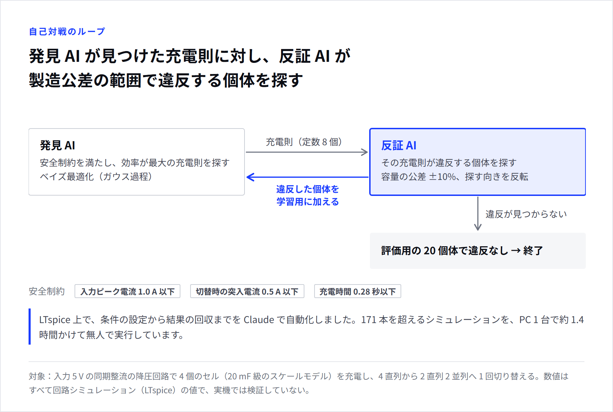
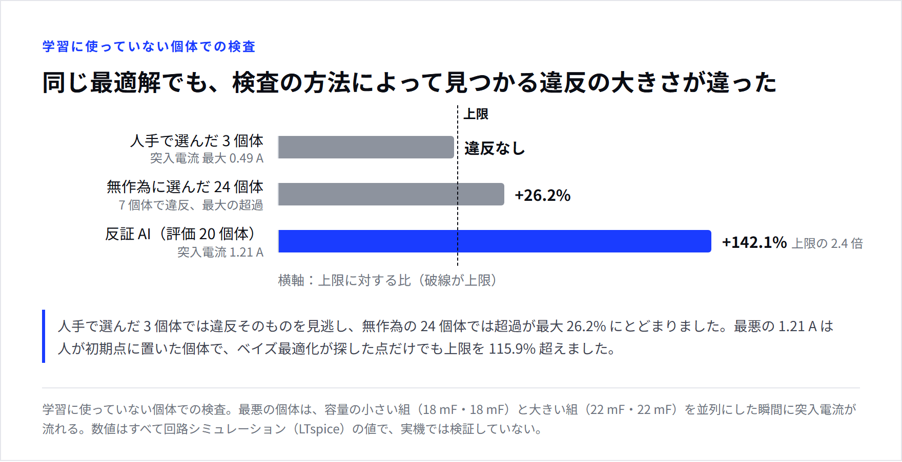
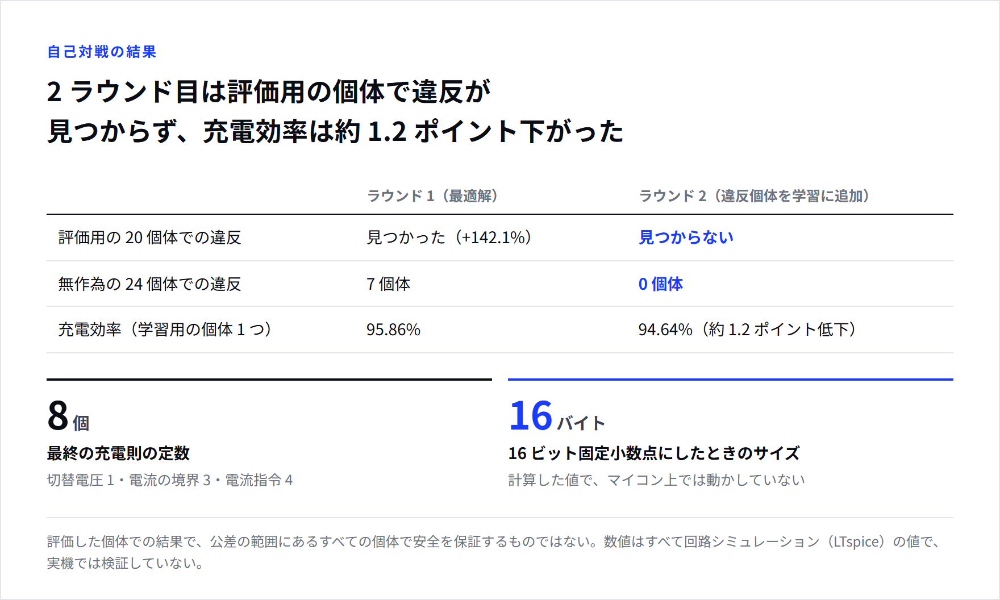

近藤悠太です。日経BP の学生AIリーダーズ大賞 2026 で、研究「AIの発見をAIに反証させる自己対戦型自律実験：製造公差にロバストなスーパーキャパシタ充電制御則の獲得と16バイトへの蒸留」が、自然科学部門の最優秀賞をいただきました。最終審査の発表は 2026 年 10 月 29 日です。

この記事では、研究の中身を、回路シミュレーションの結果とあわせて紹介します。**数値はすべて回路シミュレーションの値で、実機では検証していません。**

## 背景

AI に条件を探させる自律実験は、制約の範囲で目的（ここでは充電効率）を最大にする解を探します。その結果、解は制約の境界の近くに集まります。学習に使った部品の値の組み合わせ（以下、個体）では安全でも、製造ばらつきの範囲にある別の個体では、制約に違反することがあります。

対象にしたのは、入力 5 V の降圧回路（同期整流）で 4 個のセルを充電し、途中で 4 直列から 2 直列 2 並列へ 1 回だけ切り替える回路です。セルは 20 mF 級のスケールモデルです。安全制約は、入力ピーク電流 1.0 A 以下、切替時の突入電流 0.5 A 以下、充電時間 0.28 秒以下の 3 つです。切替を遅らせるほど効率は上がりますが、セルの個体差による突入電流は大きくなります。

## 発見 AI と反証 AI

AI が決める値は 8 個（切替電圧 1 個、電流の境界 3 個、電流指令 4 個）です。この 8 個の定数の組を、以下では充電則と呼びます。

- **発見 AI**：安全制約を満たし、効率が最大の充電則を探します。探索にはベイズ最適化（ガウス過程）を使います。
- **反証 AI**：その充電則が違反する個体を、容量の公差 ±10% の範囲から探します。発見 AI と同じ探索器で、探す向きだけを反転させています。

反証 AI が違反する個体を見つけたら、その個体を学習用の個体に加えて、発見 AI に探し直させます。評価用の 20 個体で違反が見つからなくなるまで繰り返します。ロバスト最適化と敵対的訓練そのものは、機械学習では既知の手法です。この研究では、既知の最悪条件探索を、反証 AI として自律実験のループに組み込みました。

実験はすべて LTspice 上で行い、条件の設定から結果の回収までを Claude で自動化しました。171 本を超えるシミュレーションを、PC 1 台で約 1.4 時間かけて無人で実行しています。

## 学習に使っていない個体での検査

発見 AI が見つけた最適解を、学習に使っていない個体で、検査の方法を変えて調べました。

| 検査の方法 | 結果 |
|---|---|
| 人手で選んだ 3 個体 | 違反なし（突入電流は最大 0.49 A。上限は 0.5 A） |
| 公差の範囲から無作為に選んだ 24 個体 | 7 個体で違反（上限を最大 26.2% 超過） |
| 反証 AI（評価 20 個体） | 上限を 142.1% 超過（上限の 2.4 倍） |

最悪だったのは、容量の小さい組（18 mF・18 mF）と大きい組（22 mF・22 mF）を並列にした瞬間に、1.21 A の突入電流が流れる個体です。容量の小さい組ほど電圧が上がるので、切替が遅いほど組の間の電圧差が広がります。この個体は、反証 AI の初期点として人が置いたコーナー（各部品の値を上限か下限に置いた組み合わせ）の 1 つでした。ベイズ最適化が探した点だけでも、上限を 115.9% 超える違反が見つかっています。人手で選んだ 3 個体では違反そのものを見逃し、無作為の 24 個体では違反を見つけたものの、超過は最大 26.2% にとどまっていました。

## 自己対戦の結果

1 ラウンド目で見つかった違反の個体を学習用に加えた 2 ラウンド目では、評価用の 20 個体で違反が見つからなくなりました。無作為の 24 個体での違反も、7 個体から 0 個体になりました。その代わりに、充電効率は約 1.2 ポイント下がっています（学習用の個体 1 つでの値で、95.86% から 94.64%）。評価した個体での結果で、公差の範囲にあるすべての個体で安全を保証するものではありません。

最終の充電則は定数 8 個で、16 ビットの固定小数点にすると 16 バイトに収まります。題目の「蒸留」は、ここでは定数の量子化の意味です。サイズを計算しただけで、マイコン上では動かしていません。

## AI と人の分担

生成AI には、異分野の仕組みを回路と実験に読み替える発想の段階と、回路モデルと探索コードの実装、シミュレーションの実行を任せました。採用する原理の選び方、充電時間の制約の追加、違反が起きる仕組みの物理での解釈、数値の再実行と一次資料の確認は、私が担いました。

AI が提示した設計には、シミュレーションを実行して初めて分かった不具合が 6 件ありました。入力ピーク電流が 83 A になった（同期整流のデッドタイムの論理が逆で、上下の MOSFET が同時にオンになっていた）、測定値の読み取りで時刻と値を取り違えて充電時間を 3.3 秒と報告した、などです。6 件中 5 件は、AI の説明を読むだけでは見つけられず、実行して得た数値が不自然だったことから見つけました。

## 限界

- 数値はすべて回路シミュレーションの値で、実機では検証していません。
- セルは 20 mF 級のスケールモデルで、実機を想定した容量とは時定数が違います。個体差として扱ったのは容量だけです。
- 結果は評価した個体での値です。公差の範囲のすべての個体で安全を保証するものではありません。

## おわりに

最適化が見つけた解は、学習に使った個体の外では確かめられていません。この研究では、その外側を反証 AI に探させ、人手で選んだ個体では見逃していた違反を見つけました。次は、外付けの ADC と過電流保護を実装して実機で測り、シミュレーションとの差を数で示すことに取り組む予定です。

- 学生AIリーダーズ大賞の公式ページ：https://events.nikkeibp.co.jp/xtechnext/2026tky/ailaward/
- 研究の詳細と発表スライド：https://kondo-yuta-my-portfolio.vercel.app/research/self-play-autonomous-experiment
