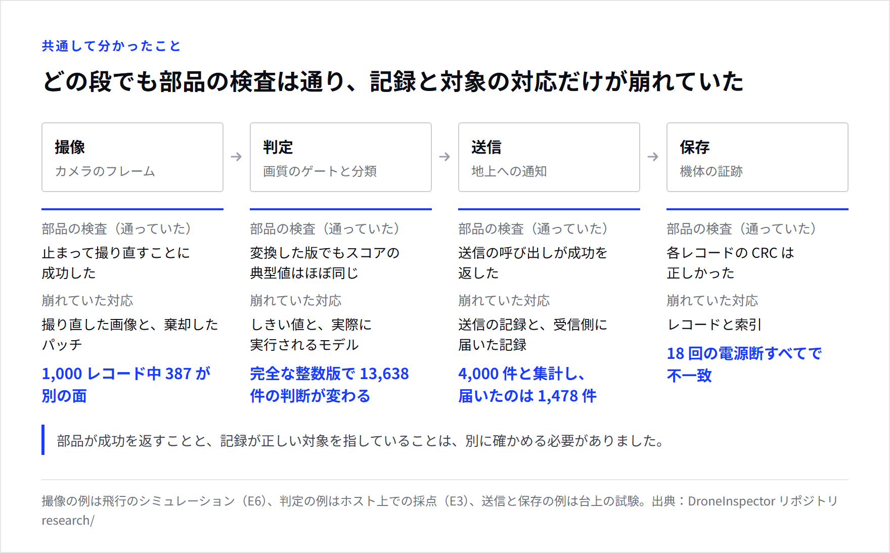
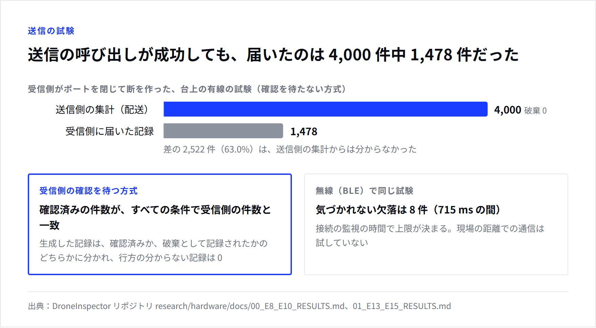
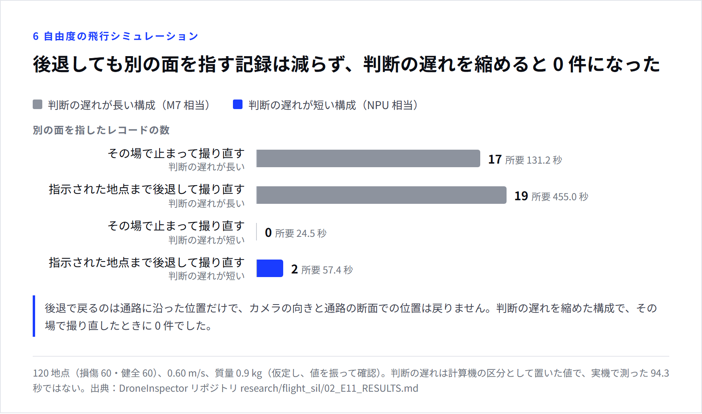

近藤悠太です。点検ドローンの研究（DroneInspector）では、改善に効きそうな案を 6 つ挙げ、同じ証拠の上で 1 層ずつ入れ替えて測りました。結果を見直すと、別々の層で同じことが起きていました。部品ごとの検査は成功を返しているのに、判定や送信、撮り直し、保存の記録が、実際の対象と対応していませんでした。

この記事では、その共通点を先に書き、6 つの比較はそれを確かめた実験として後ろに置きます。

## 比べたもの

狭いインフラ空間の点検では、使えないフレームをその場で弾く人がいません。分類器は、ぼけた画像や白飛びした画像、コントラストの低い画像にもスコアを返すので、棄却も人への委譲もないまま陰性と判定された損傷は、誰にも気づかれない見逃し（silent miss）になります。

画質のゲートも、モデルの出力の棄却も、既知の手法です。この研究で行ったのは、それぞれが監督制御の判断にどう伝わるかを、固定した証拠の上で 1 層ずつ入れ替えて比べることです。証拠には、凍結したチェックポイントで採点し直した 1,000 枚のコンクリートのパッチ（劣化なしと 8 種類の劣化）を使いました。

## 共通して分かったこと

部品が成功を返すことと、記録が正しい対象を指していることは、別の事柄でした。次の 4 つは、どれも部品の側の検査は通っていた例です。

| 設計の教訓 | 部品の側で通っていた検査 | 崩れていた対応 | 代表値 |
|---|---|---|---|
| しきい値は、機体のプロセッサが実際に実行する数値の表現で確かめる | 変換した版でも、スコアの典型的な値はほとんど変わらない | しきい値と、実際に実行されるモデル | 完全な整数版では 13,638 件の監督判断が変わり、δ = 0.50 の構成では陽性の受理が 0 件になる |
| 届いたかどうかは、受信側の確認で決める | 送信の呼び出しが成功を返した | 送信の記録と、受信側に届いた記録 | 「配送 4,000 件、破棄 0 件」と集計したが、受信側に届いたのは 1,478 件 |
| 撮り直しでは、判断の遅れと機体の動きを扱う | 止まって撮り直すことに成功した | 撮り直した画像と、棄却したパッチ | 1,000 レコード中 387 が別の面を指す |
| 1 件ずつの正しさと、ストア全体の整合を分けて確かめる | 各レコードの CRC は正しかった | レコードと索引 | 2 ファイルの手続きでは、電源断 18 回すべてで食い違う |

しきい値の教訓は E3 と E5、撮り直しの教訓は E6 から出ています。送信と保存の 2 つは、6 つの比較の後に台上で行った試験の結果です。

送信の試験では、受信側がポートを閉じた後も送信の呼び出しは成功を返し続け、送信側の集計からは 2,522 件（63.0%）の欠落が分かりませんでした。受信側の確認を待つ方式に替えると、確認済みの件数は、すべての条件で受信側の件数と一致しました。保存の試験は、別の記事に書きました。

https://zenn.dev/kd_yuta/articles/droneinspector-evidence-store

## 6 つの結果

| | 入れ替えた層 | 予想 | 測った結果 |
|---|---|---|---|
| E1 | 監督制御の状態機械を明示する | — | 67,422 ステップで決定論的なトレースと不一致 0。稼働の 57.85% が再観測 |
| E2 | リンク断に備えて証跡をためておく | 証跡を落とさなくなる | 保管では勝つが、地上への到達では勝たない。不可用率 68.86% で優劣が反転する |
| E3 | 配備する形式のモデルに替える | 変換の誤差は無視できる | 同じ画素で 66,222 件中 1,181 件の監督判断が変わる。機体で動かす完全な整数版では 13,638 件 |
| E4 | 知覚に応じて速度を変える | 賢く速く回れる | 31 通りの巡回の順序すべてで、一定の低速で掃引するのが最も安い |
| E5 | 機体のプロセッサ上で監視する | 実際に撮り直しが起きる | 60 試行 252 フレームで偽の受理は 0。ただし凍結したしきい値 0.98 は、公称のフレームを 15 枚中 0 枚しか通さない |
| E6 | 止まって撮り直す | 同じ場所を撮り直せる | 判定が出た時点で機体は通り過ぎている。1,000 レコード中 387 が別の面を指す |

6 つのうち 5 つが、その案を出したときの予想とは違う振る舞いをしました（E1 には予想を置いていません）。

## それぞれの測定の条件

結果の数字は、測った条件と切り離すと意味が変わります。どの層も、測ったのは次の範囲です。

- **E1** は MATLAB／Stateflow のモデルで、決定論的なトレースと比べました。故障や通信、保存の成否は合成した入力で、57.85% は合成した故障のキャンペーンでの割合です。見ていない入力での等価性の証明ではなく、コード生成も実機での実行もしていません。
- **E2** は、通信の回線、待ち行列、レコードをモデル化したシミュレーションです。現場での通信試験は行っていません。
- **E3** の 13,638 件は、同じ 9,000 枚をホスト上の参照の処理で採点した結果です。基板がこの 9,000 枚を採点したわけではありません。完全な整数版ではスコアが 1/256 刻みになり、上限は 0.996094 です。δ = 0.50 の構成では陽性の受理に 0.998244 を超えるスコアが要るので、陽性の受理が一度も成立しませんでした。
- **E4** の速度制御は、速度に応じて劣化の条件を選ぶモデルです。機体の力学、質量、推力、電力、実際の距離と時間は含まず、時間は無次元の量です。
- **E5** は台上の試験です。PC の画面に表示したひび割れのパッチ 1 つをカメラで撮り、劣化はセンサの露光の設定で作りました。現場と飛行の試験は行っていません。
- **E6** は飛行のシミュレーション（SIL）で、機体は飛ばしていません。その場で止まって撮り直した 396 回の再観測は、396 回すべてで別の面を撮っていました。損傷のイベントも減らずに増え、誤った損傷のイベントが 157 件（+32%）出ました。
- **送信**の 4,000 件は、USB の有線の通信で、受信側がポートを閉じて断を作った台上の試験です。無線（BLE）で同じ試験をすると、送信側が気づかないまま失った記録は 8 件（715 ms の間）にとどまりました。現場の距離での通信は試していません。

## 撮り直しの結果の補足

止まって撮り直す案は、直感的には一番効きそうに見えました。しかし、判定に時間がかかると、判定が出た時点で機体はもう次の面の前にいます。実機での推論は、160×160 画素の 1 枚で 94.3 秒（中央値）かかっており、リアルタイムではありません。

飛行を 6 自由度の剛体としてシミュレーションし直すと、この結果はよりはっきりしました。止まって撮り直す方式では 17 件が別の面を指し、指示された地点まで後退してから撮り直しても 19 件で、減りませんでした（所要時間は 3.5 倍）。後退で戻るのは通路に沿った位置だけで、カメラの向きと通路の断面での位置は戻らないためです。判断の遅れを短くした構成では 0 件でした。

ただし、このシミュレーションでの判断の遅れは計算機の区分として置いた値で、実機で測った 94.3 秒ではありません。機体の質量も仮定した値で、値を振って確かめています。撮り直すなら、低速で掃引するか、判断の遅れを削る必要がある、という結果です。

## おわりに

6 つの案は、どれも単体で考えると効きそうに見えるものでした。1 層ずつ入れ替えて同じ証拠で測ると、部品ごとの検査が通ることと、記録が正しい対象を指すことは、別々に確かめる必要があると分かりました。物理的な検証は台上の条件に限られ、飛行、消費電力、現場での精度はまだ測っていません。

- リポジトリ（測定と解析のデータは `research/`）：https://github.com/YUTAKONDO1205/DroneInspector
- 研究の詳細：https://kondo-yuta-my-portfolio.vercel.app/research/drone-inspector
