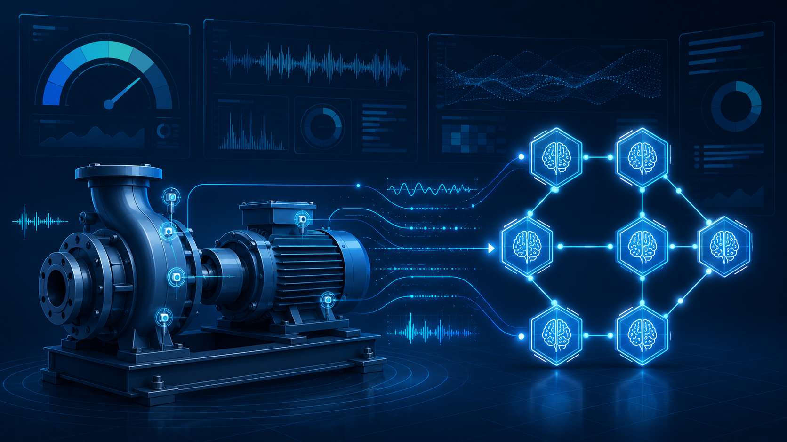
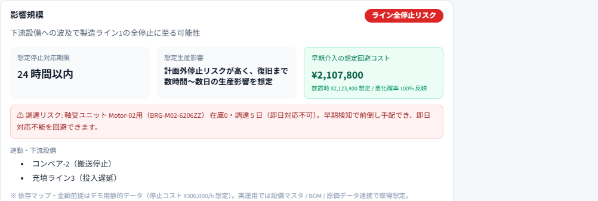
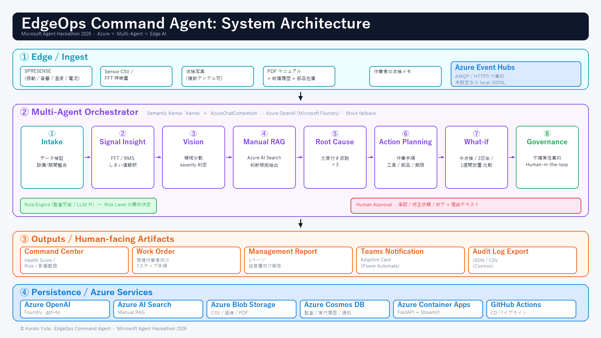
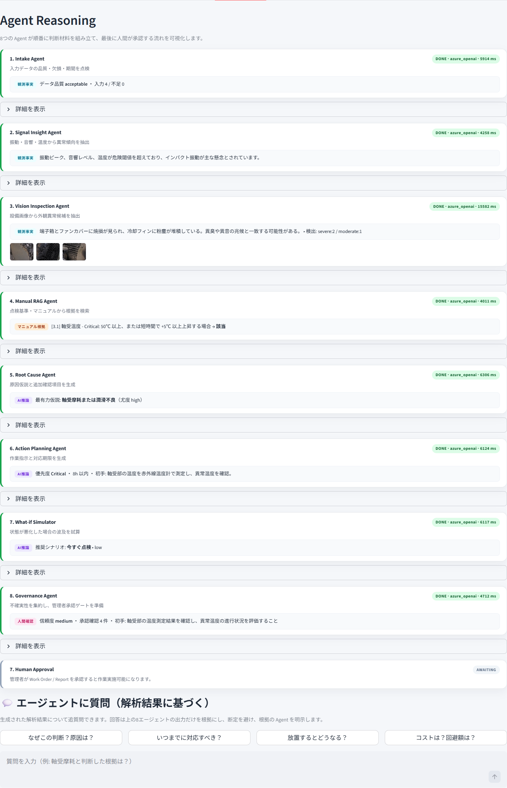
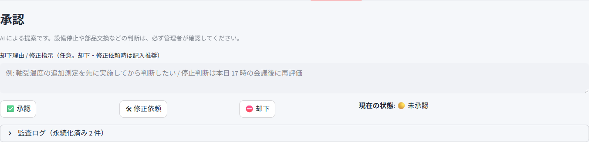
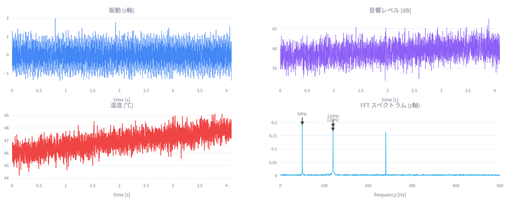

近藤悠太です。Microsoft Agent Hackathon powered by Tokyo Electron Device に、設備保全の判断と行動を支援する AI エージェント「EdgeOps Command Agent」を出し、特別賞（個人部門）をいただきました。この記事では、作ったものの構成と、判断を LLM に任せない部分の設計、評価の方法を紹介します。

- デモ動画（約 5 分）：https://youtu.be/N-M7Sm0fNi8
- リポジトリ：https://github.com/YUTAKONDO1205/EdgeOps-Command-Agent

:::message
**【追記 2026-07-09】ハッカソンの終了にあわせて、ライブデモの環境（Azure）を停止し、削除しました。**

当初この位置に載せていた Azure Container Apps の URL には、現在アクセスできません。動作はデモ動画で見られるほか、リポジトリを clone すれば、Azure の認証情報なしで（Mock mode に自動で切り替わります）全機能をローカルで試せます。手順は「ハッカソンの後の扱い」の節に置きました。

実際の Azure の環境で試したい方は、この記事のコメント欄か [GitHub Issue](https://github.com/YUTAKONDO1205/EdgeOps-Command-Agent/issues) からご連絡ください。環境を展開し直してご案内します。
:::

## 概要

- 点検データを、異常の判断、原因の推定、作業指示、管理者向けの報告書に変換する、8 つのエージェントの構成です。
- Motor-02 が Critical のとき、早く介入すれば約 ¥2,107,800 の損失を避けられると試算します。金額は LLM に計算させず、デモ用の CSV から決定論的に出します。
- 5 設備と 4 種類のデータを組み合わせた 20 プリセットで、ポリシーの検査 109 件にすべて合格しました。すべての提案に、人間の承認のゲートと監査ログを付けています。

## 作った理由

私はこれまで、SPRESENSE と振動や音響のセンサを使った異常検知を研究してきました。その中で、異常を検出するだけでは現場の行動は変わらないと考えるようになりました。現場では、何が起きているのか、なぜ起きたのか、誰が次に何をすべきかまで、判断の材料を整理する必要があります。

設備保全の現場では、判断の材料が別々の場所にあります。

- センサの値、振動と音響のログ
- 点検の写真とメモ
- 設備のマニュアルと点検の基準
- 過去の故障の履歴と作業報告書
- 部品の在庫と作業者の経験

異常が起きたとき、本当に危険か、原因は何か、今すぐ止めるべきか、誰が何を確認すべきか、報告書にどう書くか、という判断は属人化しています。手がかりがベテランの頭の中にしかないと、若手は次に何をすればよいか分かりません。異常検知の AI を入れても、この判断の部分は残ります。

## 経済効果の試算

異常を早く見つけると何円の損失を避けられるかを示すため、判断の経済効果を計算するモジュール（`src/business_case.py`）を入れました。計算は LLM に任せず、リポジトリに同梱したデモ用の CSV（`failure_history.csv` の停止時間、`parts_inventory.csv` の部品の単価、在庫、リードタイム）から決定論的に出すので、金額の根拠を後からたどれます。

計算は、放置した場合（計画外停止）と、早く介入した場合（計画停止）の差です。

```
放置コスト     = 計画外停止 downtime_h × ライン停止コスト/h ＋ 緊急部品（割増）
早期介入コスト = 計画停止枠で実施 → 生産影響≒0、部品は通常価格
回避コスト     = 放置コスト − 早期介入コスト
期待回避コスト = 回避コスト × 悪化確率（リスクレベル依存）
```

たとえば Motor-02 が Critical のとき（デモの故障履歴で 7 時間の停止、軸受は BRG-M02-6206ZZ）は、次のようになります。Critical の悪化確率は 1.0 と置いているので、期待回避コストは回避コストと同じ値です。

| 項目 | 金額 |
|---|---|
| 放置したときのコスト（計画外停止 7 時間と緊急の部品） | ¥2,123,400 |
| 早く介入したときのコスト（計画停止と通常の調達） | ¥15,600 |
| 期待回避コスト | ¥2,107,800 |

Motor-02 の軸受は在庫が 0 で、調達に 5 日かかります。早く検知できれば、その 5 日を先に手配に使えます。この金額と調達のリスクは、Command Center の影響範囲のカードと、管理者向けの報告書の冒頭（推奨する判断）に表示します。ライン停止のコスト（既定は 1 時間あたり ¥300,000）は `EDGEOPS_LINE_STOP_COST_JPY_PER_HOUR` で現場の値に差し替えられ、置いた前提は画面と報告書に書き出します。



## 作ったもの

EdgeOps Command Agent は、点検データを読み取ってから、次の順に処理します。

1. 入力データの品質の検証（Intake Agent）
2. 異常の傾向の検出（ルールベース）
3. 尤度を付けた原因の仮説（複数のエージェント）
4. マニュアルからの根拠の検索（RAG）
5. 作業指示の生成
6. 管理者向けの報告書の生成
7. 不確実性の集約と、人間の承認への引き渡し（Governance Agent）

8 つのエージェントはそれぞれ 1 つの役割だけを持ち、Root Cause Agent がほかのエージェントの出力をまとめます。デモ動画（約 5 分）で、全機能を通して見られます。

https://youtu.be/N-M7Sm0fNi8

### 画面構成

画面は 7 つのタブに分け、業務の流れを順にたどれるようにしました。

1. Command Center：設備の一覧、リスクの状態、回避コスト
2. Data Upload：生データの CSV の取り込み（列の自動マッピングとサンプリング周波数の推定）、画像、メモ、マニュアルの投入
3. Signal Analysis：時系列、FFT、統計量、ルールによる判定
4. Vision Inspection：写真と AI の所見
5. Agent Reasoning：エージェントごとの判断の過程と、根拠を示した追加の質問への回答
6. Work Order：作業指示書（承認のボタン付き）
7. Management Report：管理者向けの 1 ページの報告書

## システム構成



```
[Streamlit / Next.js UI]
    │
    ▼
[8-Agent Orchestrator (Semantic Kernel)]
  Intake → Signal → Vision → Manual RAG → Root Cause
         → Action Planning → What-if → Governance
    │            │             │
    ▼            ▼             ▼
[Risk Engine]  [Azure OpenAI]  [RAG: Azure AI Search / ローカル txt / PDF]
 (監査可能)     (Foundry)
    │
    ▼
[Cosmos DB 監査ログ] [Blob 画像/PDF] [Teams 通知] [Event Hubs (Spresense)]
```

| レイヤ | 採用した技術 |
|--------|----------|
| アプリ | Python と Streamlit（メインのデモ）／ Next.js と FastAPI（別に実装した SaaS 風の UI） |
| 信号の解析 | pandas、numpy、scipy（FFT、RMS、Welch の PSD） |
| グラフ | Plotly |
| エージェントの制御 | Semantic Kernel（`Kernel` と `AzureChatCompletion`）が主の経路。失敗したときだけ Azure OpenAI の SDK を直接呼ぶ経路に切り替え |
| 生成AI | Azure OpenAI（Microsoft Foundry） |
| 画像の解析 | Azure OpenAI の Vision 対応モデル（マルチモーダル） |
| RAG | 3 段の切り替え：Azure AI Search、ローカルの txt、アップロードした PDF（インターフェースは共通） |
| データの保存 | Azure Blob（画像と PDF）と Azure Cosmos DB（承認のログ、実行の履歴、通知の履歴）。未設定のときはローカルの `_uploaded/` と JSONL に自動で切り替え |
| 通知とエッジ | Microsoft Teams（Adaptive Card v1.4）と Azure Event Hubs（SPRESENSE のストリーム）。どちらもローカルでの代替あり |
| 実行の基盤 | Azure Container Apps（`az containerapp up --source .`、CD は GitHub Actions） |
| 監査 | 承認、修正依頼、却下と理由の文章、Cosmos の監査ログ、JSON と CSV での書き出し |

## エージェントの設計

エージェントごとの役割と、不確実性を表す出力の項目は次のとおりです。

| # | Agent | 役割 | 不確実性を表す出力 |
|---|-------|------|--------------|
| 1 | Intake | 入力データの品質、欠損、期間の妥当性を、パイプラインの入口で検証 | `data_quality` (good/acceptable/degraded), `downstream_warnings` |
| 2 | Signal Insight | センサの特徴量を所見に翻訳 | `uncertainty_notes` |
| 3 | Vision Inspection | 写真から外観の異常の候補（領域、severity、bbox、crop）を出す | `confidence_score`, `human_confirmation_required` |
| 4 | Manual RAG | マニュアルから判断のルールを引く（Azure AI Search 互換） | `applicable_rules` の `judgement` |
| 5 | Root Cause | ②③④ を統合し、尤度を付けた原因の仮説を 3 つまで出す | `uncertainty`, `human_confirmation_required` |
| 6 | Action Planning | 作業の手順、工具、部品、安全の注意を組み立てる | `manager_approval_required` |
| 7 | What-if Simulator | 今点検、3 日後、1 週間放置の、対応の時期ごとのリスクを比べる | `recommended` フラグ |
| 8 | Governance | 全エージェントの出力を集約し、人間が承認するときの確認項目を示すゲートウェイ | `overall_confidence`, `auto_executable`, `fallback_used` |
| ＋ | Report | 管理者向けの 1 ページの報告書（描画のときに呼び出す） | — |

### 1 回の実行での判断の流れ

Motor-02 が Critical のときの 1 回の実行では、各エージェントが次のように結論を出して、次のエージェントに渡します。最後に Governance がゲートを閉じます。

| Agent | この実行での結論（要約） |
|---|---|
| Intake | 入力 4 ソースが揃い `data_quality=good`。観測は 4.0 s で、傾向の解析に足りる |
| Signal Insight | 振動の RMS と軸受の帯域（100〜300 Hz）のエネルギーが同時に上昇。軸受の異常の帯域にピーク |
| Vision | フレームの表面に錆と腐食の進行（severity=severe、confidence 88） |
| Manual RAG | 「軸受温度のしきい値の超過は Critical」「振動と温度の同時の上昇は軸受の摩耗を疑う」が該当 |
| Root Cause | 仮説①軸受の摩耗（likelihood: high）／②固定部の緩み（medium）／③潤滑の不良（medium） |
| Action Planning | priority=Critical、deadline 24h、必要な部品 BRG-M02-6206ZZ、管理者の承認が必須 |
| What-if | 今点検＝低リスク（推奨）／3 日後＝中／1 週間放置＝高（非推奨） |
| Governance | overall_confidence、`auto_executable=false`（人間の承認のゲート）、確認項目と安全の制約を提示 |

LLM を 1 回呼び出すだけの構成では、誰がどの根拠で何を結論したかが 1 つの文章に混ざり、後から監査することも、一部だけを差し替えることも難しくなります。役割を分けておけば、Manual RAG だけを Azure AI Search に替える、Vision だけを別のモデルにする、といった現場ごとの調整ができます。



### ルールベースの判定と LLM の分担

設備保全では、最終の判断を AI に任せることは、今のところ現実的ではないと考えました。リスクのレベルは後から根拠をたどれる必要があるので、しきい値による分類（`src/risk_engine.py`）は LLM の外に置いています。LLM に任せるのは、数値の解釈、文章にすること、原因の仮説、報告書の生成だけです。

## プロンプトの設計

すべてのエージェントの出力は JSON に固定し、`response_format={"type": "json_object"}` で構造化しました。プロンプトでは、次のことを求めています。

1. 断定しない（「腐食です」ではなく「腐食の可能性があります」と書く）
2. 不確実性を明示する（各エージェントが `uncertainty` と `human_confirmation_required` を返す）
3. 根拠と推測を分ける（`evidence` と `root_cause_hypotheses` を別の項目にする）

Root Cause Agent のプロンプトの一部です。

```python
ROOT_CAUSE_AGENT_PROMPT = """\
あなたは「Root Cause Agent」です。
信号解析、画像所見、マニュアル根拠、過去故障履歴を統合し、
原因仮説を尤度付きで3つまで出してください。

# 出力スキーマ（JSONのみ）
{
  "abnormality_summary": "...",
  "evidence": [...],
  "root_cause_hypotheses": [
    {"cause": "...", "likelihood": "high|medium|low", "reason": "...",
     "additional_checks": [...]}
  ],
  "uncertainty": "...",
  "human_confirmation_required": true
}

# 制約
- 1つに断定しない。複数仮説を出す
- 根拠は入力データに対応していること
- 不確実なら likelihood を low にする
"""
```

## 判断が難しいデータ

デモ用に、4 種類のセンサの CSV を用意しました。

| データ | 状態 | 確かめたい挙動 |
|--------|------|--------------|
| `normal_sensor.csv` | 正常 | AI が過剰に反応しない |
| `warning_sensor.csv` | 軽度の異常 | 経過の観察と追加の確認を提案する |
| `critical_sensor.csv` | 深刻な異常 | 作業指示と報告書まで生成する |
| `ambiguous_sensor.csv` | 判断が難しい | 不確実性と、人による確認を出す |

このうち `ambiguous` は、断片的なスパイクだけを含むデータです。このデータには、確信度を低くし、現場での確認を勧める出力を返します。確信が持てないときに答えを断定せず、人に判断を渡すことを、この作品で最も重視しました。

## 人間の承認（Human-in-the-loop）

すべての提案には人間の承認が必要だという印が付き、画面で承認、修正依頼、却下のどれかを選びます。Work Order と Management Report の両方に承認の部品を置き、選んだ理由の文章とあわせて、Cosmos DB に監査ログとして残します（JSON と CSV で書き出せます）。設備保全に AI を入れるときに要る合意の手続きを、画面の機能として作りました。



## 軸受の帯域のエネルギー比

信号の解析には、100〜300 Hz の帯域のエネルギーが全体に占める比を入れました。デモのセンサデータは、回転数 50 Hz の遠心ポンプを想定して合成したもので、軸受の異常として 120 Hz と 240 Hz の成分を加えてあります。

```python
def _bearing_band_ratio(signal, fs):
    f, pxx = welch(signal - signal.mean(), fs=fs, nperseg=256)
    total = trapezoid(pxx, f)
    mask = (f >= 100.0) & (f <= 300.0)
    band = trapezoid(pxx[mask], f[mask]) if mask.any() else 0.0
    return band / total
```

Critical のデモデータでは、この比が 0.69 になります（正常のデータでは 0.10 程度）。FFT のグラフにも 120 Hz のピークが出ます。FFT で周波数の特徴量を作る処理は、SPRESENSE と振動センサの研究でも使ってきたものです。



## Azure の構成とデプロイ

```bash
az login
az group create --name rg-edgeops-agent --location japaneast
az containerapp up \
  --name edgeops-command-agent \
  --resource-group rg-edgeops-agent \
  --location japaneast \
  --source . \
  --ingress external \
  --target-port 8501
```

`az containerapp up --source .` は、ローカルの Dockerfile をビルドして ACR にプッシュし、Container Apps を起動します。

ただし、Azure CLI 2.86.0 では、`az containerapp up --source .` の内部で `OS.linux.value` を参照する箇所が None になって失敗しました。そこで、`az acr create`、`docker build`、`docker push`、`az containerapp env create`、`az containerapp create --image ...` の 5 つの手順に分けてデプロイしました（GitHub の README に再現の手順を残しています）。

審査の期間中は、公開した URL を開くだけで全機能を試せるようにしていました。Azure OpenAI の認証情報が設定されていないときは Mock mode に自動で切り替わるので、ネットワークの調子が悪いときもデモは最後まで動きます。推論の本来の経路は Azure OpenAI（Microsoft Foundry）で、Azure に接続できるときは常に実際のモデルを使います（`EDGEOPS_USE_MOCK` か、endpoint と key の有無で切り替えます）。

### ハッカソンの後の扱い

ハッカソンの期間が終わったので、公開デモに使っていた Azure のリソース（Container App 本体と Managed Environment、Container Registry、ログ用の Log Analytics ワークスペース、推論に使っていた Azure OpenAI の `gpt-4o` のデプロイ）は、すべて削除しました。個人で常に起動しておく構成ではないためです。冒頭に載せていたデモの URL も、そのときに停止しました。

動かして確かめることは、Azure がなくてもできます。Mock mode への切り替えは `src/utils.py` の `use_mock_mode()` が行い、`EDGEOPS_USE_MOCK` が指定されていなければ、`AZURE_OPENAI_ENDPOINT` と `AZURE_OPENAI_API_KEY` の有無で決めます。`.env` を置かなければ、そのまま Mock mode で起動します。

```powershell
git clone https://github.com/YUTAKONDO1205/EdgeOps-Command-Agent.git
cd EdgeOps-Command-Agent
python -m venv .venv
.\.venv\Scripts\Activate.ps1
pip install -r requirements.txt
streamlit run app.py   # → http://localhost:8501
```

これで、7 つのタブ、8 つのエージェントの判断の過程、4 種類のデモデータ（normal / warning / critical / ambiguous）、人間の承認の流れまでを試せます。評価のハーネス（`python scripts/run_eval.py`）も Mock mode で決定論的に動くので、次の節の 20/20 プリセット、109/109 チェックの結果を手元で再現できます。

## エージェントの品質の検査

8 つのエージェントが設計どおりに振る舞うかを、人手で採点せずに確かめるため、評価のハーネス（`scripts/run_eval.py`）を用意しました。5 設備と 4 種類のデータ（normal / warning / critical / ambiguous）を組み合わせた 20 プリセットを Mock mode で決定論的に実行し、出力がスキーマに合っているか、ポリシーを満たしているかを検査します（GitHub Actions でも `scripts/run_eval.py` と `pytest` を実行しています）。

検査する不変条件の一部です。

- Critical の作業指示は、必ず管理者の承認が必須で、期限が 24 時間以内
- Normal でないときは `auto_executable=false`（人間の承認のゲートが必ず閉じる）
- あいまいさを検出したときは `human_confirmation_required=true`
- What-if は常に今、3 日後、1 週間放置の 3 つのシナリオを返し、放置は `recommended=false`

結果は、20 プリセットのすべてがポリシーを満たし、検査 109 件もすべて合格しました。詳細は `docs/eval_results.md` にあります。ただし、検査の対象は Mock mode の出力で、実際の Azure OpenAI の出力が毎回この条件を満たすことを確かめたものではありません。

## 実際の導入を考えて入れた機能

ここまでの節で触れたもののほかに、次の機能を入れました。

- 実機の CSV の取り込み（任意の列名とサンプリングレートに、列の自動マッピングで対応）
- 解析結果への追加の質問（根拠にしたエージェントを示し、断定を避けて答える）
- 報告書の Markdown でのダウンロード（Teams や紙にそのまま渡せる形）
- Microsoft Teams への通知（Adaptive Card v1.4。Power Automate や Logic Apps による実際の通知へ広げられる形）
- 影響範囲のカード（Warning と Critical のときに、影響の規模、停止に対応する期限の目安、生産への影響の目安、連動する下流の設備を表示。例：Pump-03 → Tank-A の送液の停止、Reactor-1 の原料の供給の遅れ。実際の運用では、設備マスタや BOM との連携で依存の関係を差し替える前提）

## おわりに

研究では、異常を見つけるところまでを何度も作ってきました。EdgeOps Command Agent では、その先の判断を、8 つのエージェントと人間の承認で現場の行動につなげることを試みました。今後は、次のことに取り組む予定です。

- 過去の事例（Cosmos に蓄積したもの）を Root Cause Agent の RAG の情報源に組み込み、事例に基づいて推論する
- Power Automate と連携し、異常、Teams への通知、承認、作業指示の配布までを 1 つの業務の流れにする
- ライン停止のコスト、BOM、設備マスタを実際のデータと連携し、経済効果の試算を現場の値で出す
- SPRESENSE の実機から常にデータを流して運用する

ライブ環境はハッカソンの終了とともに停止しましたが、手元で動かす手順は「ハッカソンの後の扱い」の節に残しました。実際の Azure の環境で試したい方は、コメント欄か GitHub Issue からご連絡ください。

Microsoft Agent Hackathon powered by Tokyo Electron Device で、この作品を特別賞に選んでいただきました。運営と審査員の皆様、開発を支えてくださった方々に感謝します。

- デモ動画：https://youtu.be/N-M7Sm0fNi8
- リポジトリ：https://github.com/YUTAKONDO1205/EdgeOps-Command-Agent
