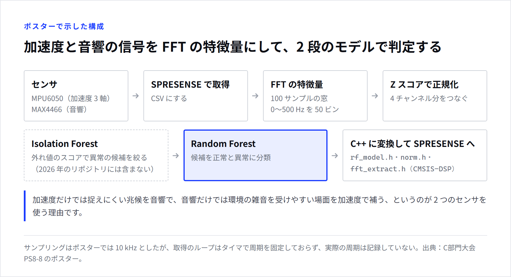
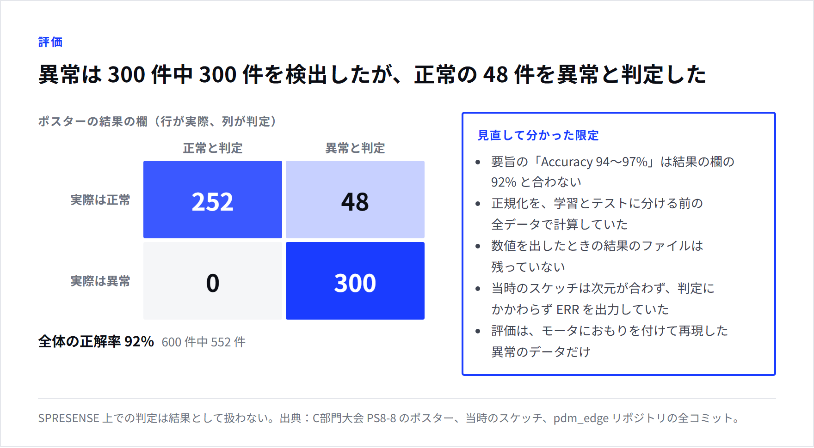

近藤悠太です。2025 年 8 月に金沢工業大学で開かれた電気学会 電子・情報・システム部門大会（C部門大会）の学生ポスターセッションで、「振動・音響センサを用いた異常兆候検知システムの開発と AI 識別モデル構築」を発表しました（PS8-8）。

この記事では、ポスターで発表した内容と、この記事を書くために当時の資料とコードを見直して分かった限定を書きます。

## 構成

SPRESENSE に、3 軸の加速度センサ（MPU6050）と音響センサ（MAX4466）をつなぎ、両方の信号を取得します。加速度だけでは捉えにくい異常の兆候を音響で補い、音響だけでは環境の雑音を受けやすい場面を加速度で補うために、2 つのセンサを組み合わせています。

処理は、取得した信号を CSV にし、FFT で特徴量を抽出して正規化し、PC で学習したモデルを C++ に変換して SPRESENSE に実装する、という流れです。ポスターでは、Isolation Forest で外れ値のスコアを出して異常の候補を絞り、その候補だけを Random Forest で正常と異常に分類する構成を示しました。

SPRESENSE 側のプログラムは、次のファイルに分けています。

- `rf_model.h`：決定木の構造（学習したモデルを C++ に変換したもの）
- `norm.h`：正規化に使う平均と標準偏差
- `fft_extract.h`：FFT の処理（CMSIS-DSP を使用）
- `sensors.cpp`：センサの取得
- `pdm_edge_sketch.ino`：全体の制御と推論のループ

## 特徴量

信号を 100 サンプルごとの窓に分け、窓ごとに FFT をかけて、0〜500 Hz の帯域を 50 のビンに縮約しました。4 チャンネル分をつないだ特徴量を、Z スコアで正規化してからモデルに渡します。

## 評価

モータにおもりを付けて、異常の状態を再現しました。正常のデータではスペクトルが特定の帯域にピークを持つのに対し、異常のデータではエネルギーが複数の周波数帯に分散していました。

ポスターの結果の欄に載せた分類の結果は、次のとおりです。

| 区分 | 結果 |
|---|---|
| 正常を正常と判定 | 300 件中 252 件（84%） |
| 異常を異常と判定 | 300 件中 300 件（100%） |
| 全体の正解率 | 92% |

## 見直して分かった限定

- ポスターの冒頭の要旨には「Accuracy 94〜97%」と書きましたが、結果の欄に載せた混同行列の値は 92% でした。この記事では結果の欄の値を載せています。
- サンプリングはポスターでは 10 kHz としていましたが、取得のループは 1 サンプルごとに読み取りと 100 µs の待ちを入れる作りで、タイマで周期を固定していません。実際の周期は記録しておらず、周波数の値は 10 kHz を前提にした値です。
- 正規化の平均と標準偏差を、学習用とテスト用に分ける前の全データで計算していました。そのため、テストの値は楽観的に出ている可能性があります。
- ポスターの数値を出したときの結果のファイルは残っていません。2026 年に作り直したリポジトリは Random Forest の学習と変換だけを含み、Isolation Forest の段は含んでいないので、ポスターの数値はリポジトリからは再現できません。
- 手元に残っている当時の SPRESENSE のスケッチは、特徴量の次元（64）と正規化の配列の長さ（32）が合っておらず、判定の結果にかかわらず ERR を出力する作りでした。SPRESENSE 上での判定は、この記事では結果として扱いません。
- 評価は、モータにおもりを付けて再現した異常のデータだけで行いました。現場の設備のデータでは評価していません。

## おわりに

このポスターで、2024 年に作った振動の監視の作品に、音響のセンサと周波数の特徴量による判定を加えました。見直してみると、結果の数値よりも先に、サンプリングの周期を固定すること、正規化をテストのデータから切り離すこと、学習側と SPRESENSE 側で特徴量の作り方を一致させることが必要でした。PC で学習したモデルを SPRESENSE で動かす部分は、2026 年にリポジトリとして作り直しています。

- C部門大会のプログラム（PDF）：https://www.iee.jp/eiss/wp-content/uploads/sites/4/2025/07/program20250718.pdf
- 2024 年の振動の監視の作品：https://zenn.dev/kd_yuta/articles/spresense-lora-vibration-2024
- リポジトリ：https://github.com/YUTAKONDO1205/pdm_edge
- 研究の詳細：https://kondo-yuta-my-portfolio.vercel.app/research/pdm-edge
