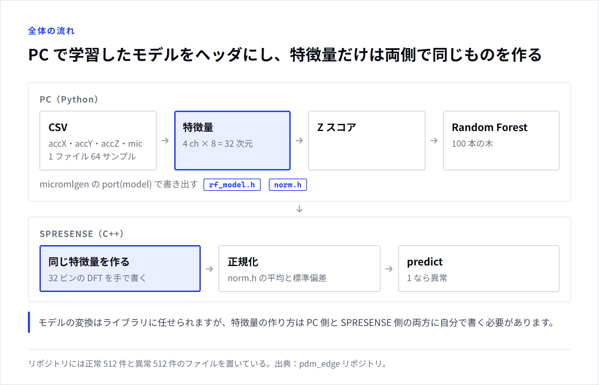
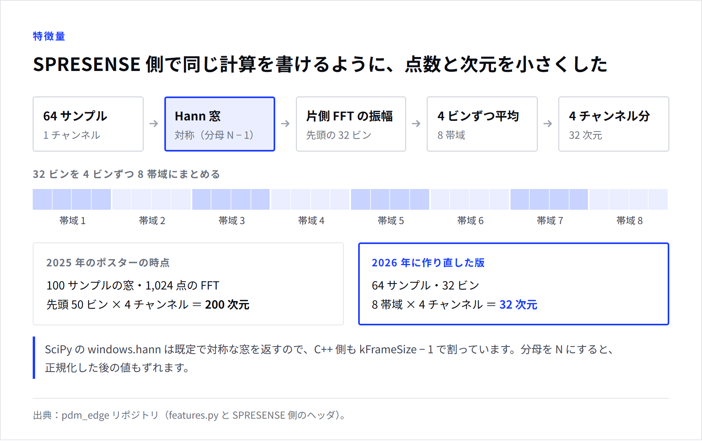
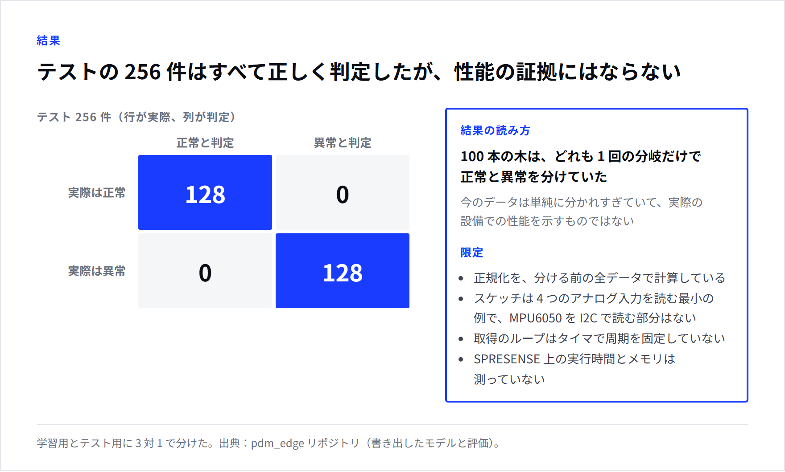

近藤悠太です。加速度と音響の信号から設備の異常を判定する研究（pdm_edge）で、PC で学習した Random Forest を C のヘッダファイルに変換し、SPRESENSE から呼び出す部分を、2026 年にリポジトリとして作り直しました。この記事では、その構成と、学習側と SPRESENSE 側で特徴量を一致させるために気をつけた点を書きます。

2025 年に電気学会 C部門大会で発表したポスターの内容は、別の記事に書きました。

https://zenn.dev/kd_yuta/articles/ieej-c2025-vibration-acoustic-poster

## 全体の流れ

入力は、加速度 3 軸（accX・accY・accZ）と音響（mic）の 4 列を持つ CSV で、1 ファイルが 64 サンプルです。リポジトリには、正常 512 件と異常 512 件のファイルを置いています。

1. 各チャンネルから周波数の特徴量を作る（4 チャンネル × 8 = 32 次元）
2. 特徴量を Z スコアで正規化する
3. Random Forest（100 本の木）を学習する
4. 学習したモデルを `micromlgen` で C++ のヘッダ（`rf_model.h`）に変換し、正規化の平均と標準偏差を `norm.h` に書き出す
5. SPRESENSE 側で、同じ特徴量を作り、正規化して、モデルの `predict` を呼び出す



## 特徴量

1 チャンネル 64 サンプルに Hann 窓をかけて片側 FFT をとり、先頭の 32 ビンを 4 ビンずつ平均して 8 つの帯域の値にします。

```python
prepared = _prepare_signal(np.asarray(signal, dtype=np.float64), config.fft_size)  # 64 サンプル
windowed = prepared * windows.hann(config.fft_size)
spectrum = np.abs(rfft(windowed))[: config.spectrum_bins]                           # 先頭 32 ビン
features = [spectrum[i : i + config.band_width].mean()
            for i in range(0, config.spectrum_bins, config.band_width)]             # 8 帯域
```

2025 年のポスターの時点では、100 サンプルの窓に 1,024 点の FFT をかけ、先頭の 50 ビンを 4 チャンネル分つないだ 200 次元の特徴量を使っていました。作り直した版では、SPRESENSE 側で同じ計算をそのまま書けるように、点数と次元を小さくしています。



## SPRESENSE 側で同じ特徴量を作る

SPRESENSE 側では、FFT のライブラリを使わず、32 ビンだけの DFT を C++ で書いて、学習側と同じ帯域の平均を作っています。

```cpp
inline float HannWindow(int index) {
    return 0.5f - 0.5f * cosf((2.0f * kPi * index) / (kFrameSize - 1));
}

inline void ExtractBandFeatures(const float* signal, float* output) {
    float spectrum[kSpectrumBins];
    for (int k = 0; k < kSpectrumBins; ++k) {
        float real_part = 0.0f, imag_part = 0.0f;
        for (int n = 0; n < kFrameSize; ++n) {
            const float sample = signal[n] * HannWindow(n);
            const float angle = (2.0f * kPi * k * n) / kFrameSize;
            real_part += sample * cosf(angle);
            imag_part -= sample * sinf(angle);
        }
        spectrum[k] = sqrtf(real_part * real_part + imag_part * imag_part);
    }
    /* 4 ビンずつ平均して 8 帯域にする */
}
```

ここで合わせる必要があったのは、窓関数の定義です。SciPy の `windows.hann` は既定で対称な窓（分母が N − 1）を返すので、C++ 側も `kFrameSize - 1` で割っています。分母を N にすると、学習時と少し違う特徴量になり、正規化した後の値もずれます。特徴量を作った後は、`norm.h` の平均と標準偏差で正規化し、`Eloquent::ML::Port::RandomForest` の `predict` に渡して、1 なら異常と判定します。

## 結果

学習用とテスト用に 3 対 1 で分けたテスト 256 件（正常 128・異常 128）では、すべて正しく判定しました。ただし、書き出したモデルを見ると、100 本の木はどれも 1 回の分岐だけで正常と異常を分けていました。今のデータは単純に分かれすぎていて、この結果は実際の設備での性能を示すものではありません。



## 限定

- 正規化の平均と標準偏差を、学習用とテスト用に分ける前の全データで計算しています。テスト用のデータを正規化の計算から切り離す必要があります。
- リポジトリのスケッチは、4 つのアナログ入力を読む最小の例で、MPU6050 を I2C で読む部分は含めていません。学習に使ったデータとセンサの値の単位が違うので、実際に使う前に入力をそろえる必要があります。
- 取得のループは 100 µs の待ちを入れているだけで、タイマでサンプリングの周期を固定していません。
- SPRESENSE 上での実行時間とメモリの使用量は測っていません。

## おわりに

PC で学習したモデルをマイコンで動かすとき、モデルの変換はライブラリに任せられますが、特徴量の作り方は自分で両側に書く必要があります。窓関数の分母 1 つでも値が変わるので、学習側と SPRESENSE 側で同じ入力から同じ特徴量が出るかは、数値で照合して確かめる必要があります。

- リポジトリ：https://github.com/YUTAKONDO1205/pdm_edge
- 研究の詳細：https://kondo-yuta-my-portfolio.vercel.app/research/pdm-edge
