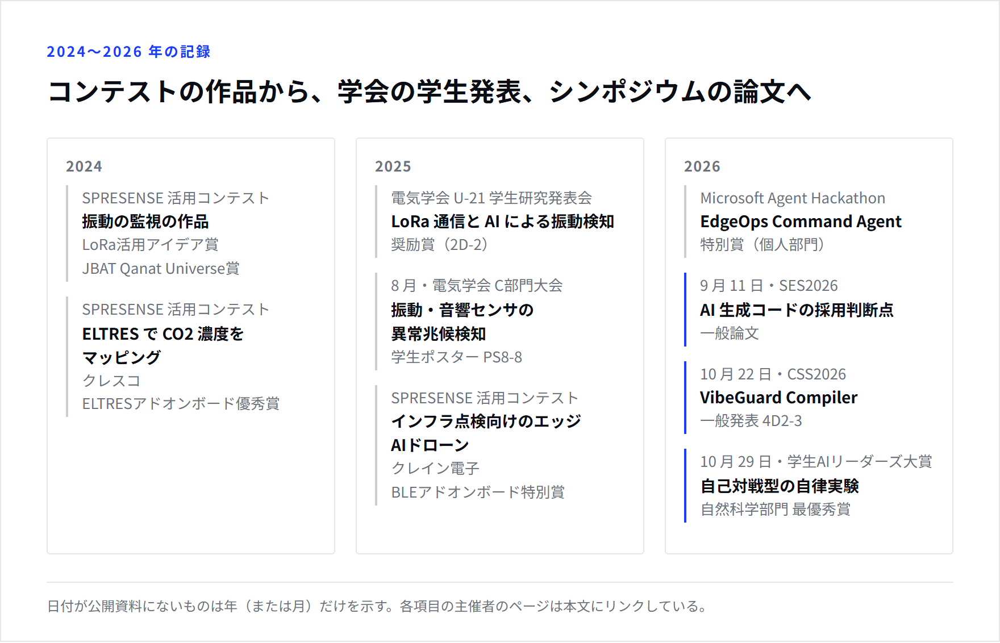
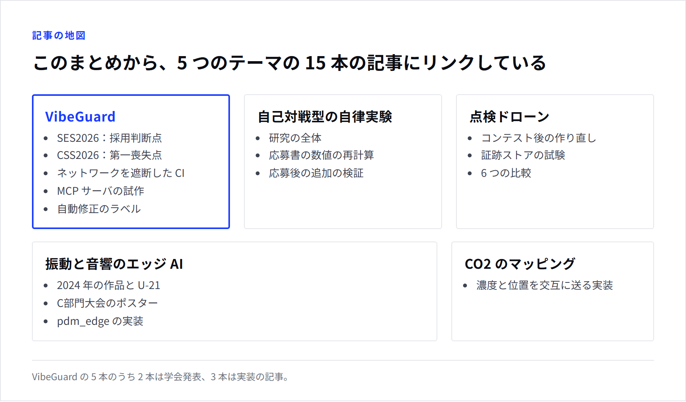

近藤悠太（Yuta Kondo）です。SPRESENSE 上で動作するエッジ AI の研究と、AI 生成コードの診断ツール VibeGuard の開発をしています。

この記事は、2024 年から 2026 年までの学会発表と受賞の記録です。発表のプログラムや受賞者の一覧は主催者ごとに別々のページに載るので、自分でも探しにくくなっていました。ここに一覧にして、主催者のページと、内容を詳しく書いた記事へリンクします。

## 学会発表

### SES2026 一般論文（情報処理学会 ソフトウェアエンジニアリングシンポジウム 2026）

「AI生成コードの採用判断点に基づくマルチコンテキストセキュリティ診断配置方式の提案とVibeGuardによる検証」

2026 年 9 月 11 日に、慶應義塾大学 日吉キャンパスで発表しました。セッションはコード解析・セキュリティ・テスト支援で、単著の論文です。

AI 生成コードの安全確認を、そのコードを採用するかを人が決める場面の問題として扱い、その場面への診断の置き方を提案しました。VibeGuard では、コードを書くとき（VS Code）、読むとき（Chrome）、マージする前（GitHub Actions）に同じ解析エンジンが動作します。

- 記事：https://zenn.dev/kd_yuta/articles/ses2026-vibeguard-adoption-points
- プログラム：https://ses.sigse.jp/2026/program.html
- 予稿：ソフトウェアエンジニアリングシンポジウム2026論文集、pp. 78–85（[情報処理学会 電子図書館](https://ipsj.ixsq.nii.ac.jp/records/2011748)）

2026 年 11 月 14 日の時点では、情報処理学会の電子図書館がシステムメンテナンスで停止していて、予稿のページは開けません。

### CSS2026 一般発表 4D2-3（情報処理学会 コンピュータセキュリティシンポジウム 2026）

「VibeGuard Compiler：コンパイラ最適化におけるセキュリティ性質消失の追跡と第一喪失点の特定」

2026 年 10 月 22 日に、浜松のセキュア開発 2 のセッションで発表しました。

ソースコードに書いた防御が、コンパイルの途中で失われることがあります。VibeGuard Compiler は、その防御が最初に失われた工程（第一喪失点）を、コンパイラを改変せずに特定する方式です。

- 記事：https://zenn.dev/kd_yuta/articles/css2026-vibeguard-compiler
- プログラム：https://www.iwsec.org/css/2026/program.html

### 電気学会 電子・情報・システム部門大会 2025 学生ポスター PS8-8

「振動・音響センサを用いた異常兆候検知システムの開発と AI 識別モデル構築」

2025 年 8 月に金沢工業大学で開かれた電気学会 C部門大会の、学生ポスターセッションで発表しました。加速度 3 軸と音響の 4 チャンネルを FFT で周波数の特徴量に変換し、Random Forest で判定する構成です。学習したモデルはヘッダファイルに変換し、SPRESENSE から呼び出せるようにしました。

- 記事（ポスターの内容）：https://zenn.dev/kd_yuta/articles/ieej-c2025-vibration-acoustic-poster
- 記事（学習したモデルを SPRESENSE から呼び出す実装）：https://zenn.dev/kd_yuta/articles/pdm-edge-rf-header-spresense
- プログラム（PDF）：https://www.iee.jp/eiss/wp-content/uploads/sites/4/2025/07/program20250718.pdf
- 研究の詳細：https://kondo-yuta-my-portfolio.vercel.app/research/pdm-edge

### 電気学会 U-21 学生研究発表会 2025 奨励賞（2D-2）

「LoRa通信とAIを活用した振動検知による異常予知システムの構築」

LoRa 通信と AI を組み合わせて、設備の振動を遠隔から監視するシステムの発表で、奨励賞をいただきました。2024 年の SPRESENSE 活用コンテストに出した振動解析の作品と同じテーマです。

- 記事（2024 年の作品と U-21 の発表）：https://zenn.dev/kd_yuta/articles/spresense-lora-vibration-2024
- 受賞者の一覧：https://www.iee.jp/u-21-2025-award/

## 受賞

### 学生AIリーダーズ大賞 2026 自然科学部門 最優秀賞（日経BP）

「AIの発見をAIに反証させる自己対戦型自律実験：製造公差にロバストなスーパーキャパシタ充電制御則の獲得と16バイトへの蒸留」

2026 年 10 月 29 日の最終審査で発表し、自然科学部門の最優秀賞をいただきました。充電制御則を探す発見 AI と、その制御則が違反する部品の値の組み合わせを製造ばらつきの範囲から探す反証 AI を対戦させる研究です。実験はすべて LTspice の回路シミュレーションで、実機では検証していません。

- 記事（研究の全体）：https://zenn.dev/kd_yuta/articles/ai-leaders-2026-self-play-experiment
- 記事（応募書の数値を計算し直した話）：https://zenn.dev/kd_yuta/articles/self-play-claims-recheck
- 記事（応募後の追加の検証）：https://zenn.dev/kd_yuta/articles/self-play-post-application-checks
- 大賞の公式ページ：https://events.nikkeibp.co.jp/xtechnext/2026tky/ailaward/

### Microsoft Agent Hackathon 2026 特別賞（個人部門）

設備の点検データから、異常の判定、原因の推定、作業指示、報告書までを出力する 8 エージェントの保全 AI「EdgeOps Command Agent」です。出力ごとに人が承認、修正依頼、却下を選び、その操作を監査ログに残します。

- 記事：https://zenn.dev/kd_yuta/articles/edgeops-command-agent

### SPRESENSE 活用コンテスト（2024 年、2025 年）

- 2025 年 クレイン電子 BLEアドオンボード特別賞：[SPRESENSEでインフラ点検向けのエッジAIドローン](https://elchika.com/article/663a49cf-c895-44d7-a989-6e45e7d92056/)
- 2024 年 クレスコ ELTRESアドオンボード優秀賞：[SPRESENSEとELTRES通信でCO2濃度をマッピング](https://elchika.com/article/504f286c-413b-47d3-89f9-38920ca5e5c7/)
- 2024 年 LoRa活用アイデア賞、JBAT Qanat Universe賞：[SPRESENSEと振動解析による設備保全の最前線](https://elchika.com/article/ac986cc9-5c24-4778-952d-a3ec8dca25d0/)

受賞作品の一覧は、[2025 年](https://elchika.com/promotion/spresense2025/winner/)と[2024 年](https://elchika.com/promotion/spresense2024/winner/)の発表ページにあります。Elchika ではユーザー名 kd_yuta で投稿しています。作品の記事と、コンテストの後に作り直した内容は、次の記事に書きました。

- 振動の監視の作品（2024 年）：https://zenn.dev/kd_yuta/articles/spresense-lora-vibration-2024
- 点検ドローンの作り直し：https://zenn.dev/kd_yuta/articles/spresense-drone-contest-2025
- 点検ドローンの証跡ストア：https://zenn.dev/kd_yuta/articles/droneinspector-evidence-store
- 点検ドローンの改善案 6 つの比較：https://zenn.dev/kd_yuta/articles/droneinspector-six-layers
- CO2 濃度と位置を交互に送る実装：https://zenn.dev/kd_yuta/articles/spresense-eltres-co2-mapping

## VibeGuard の実装の記事

学会発表とは別に、VibeGuard の実装で決めたことを 3 本の記事に書きました。

- ネットワークを遮断した CLI と結果を比べる CI：https://zenn.dev/kd_yuta/articles/vibeguard-offline-parity-ci
- ファイルを書く前に診断する MCP サーバの試作：https://zenn.dev/kd_yuta/articles/vibeguard-mcp-guard-poc
- 自動修正の safe / needs-review のラベル：https://zenn.dev/kd_yuta/articles/vibeguard-autofix-safety-labels

## おわりに

2024 年はコンテストの作品記事、2025 年は電気学会の学生向けの発表、2026 年は情報処理学会のシンポジウムの論文と、書くものが毎年変わりました。

数値については、一度出した値を自分で訂正したことがあります。学生AIリーダーズ大賞では、応募書に書いた主張 43 件を、提出した結果ファイルから項目ごとに計算し直し、一致しなかった 3 件を訂正しました。また、「安全な条件をランダム探索の 2.8 倍見つけた」と書いた値は、乱数の種を変えて実行し直すと約 1.6 倍でした。応募書には、種を 1 通りしか試していない実行の倍率を書いていました。

研究の一覧と、コードやストアへのリンクはポートフォリオにまとめています。

https://kondo-yuta-my-portfolio.vercel.app/
