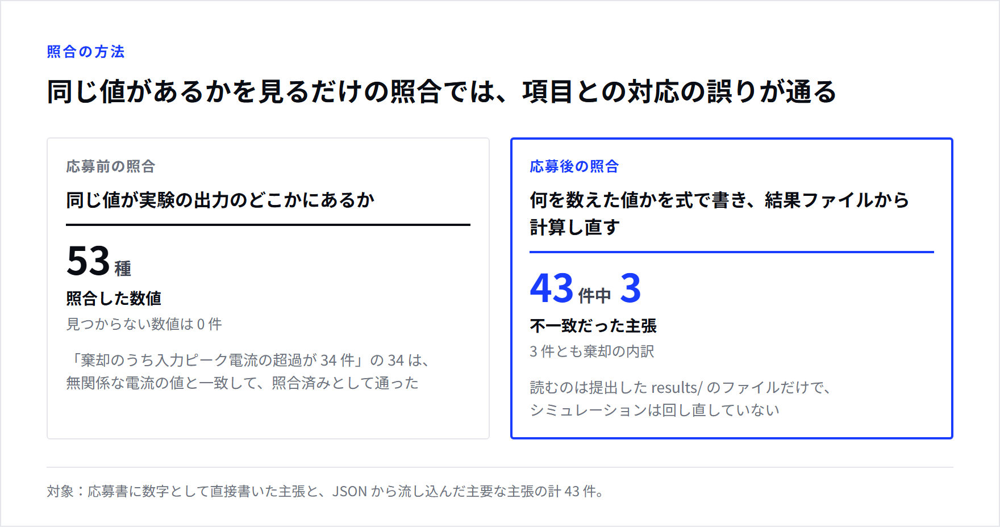
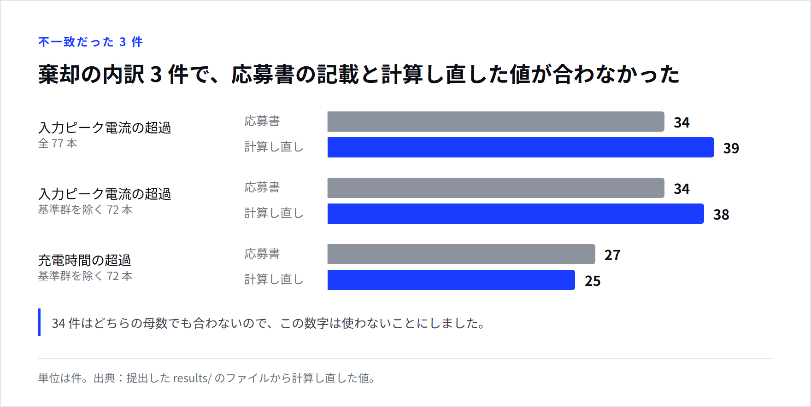
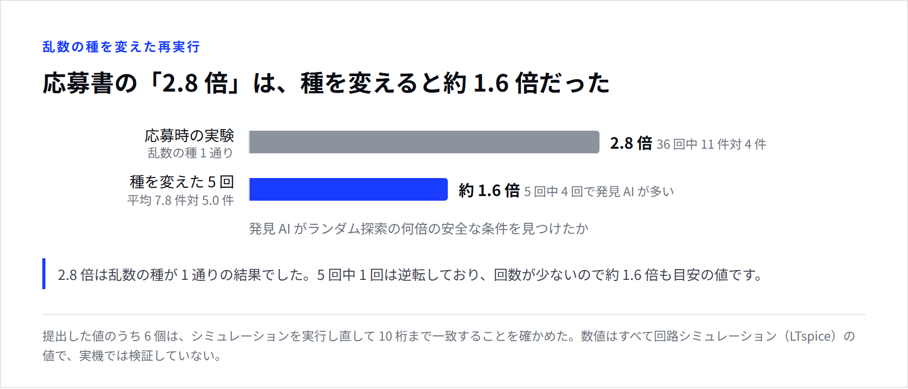

近藤悠太です。学生AIリーダーズ大賞 2026 に応募した研究（自己対戦型の自律実験）では、実験の大部分と応募書の数値の流し込みを Claude で自動化しました。応募した後に、応募書に書いた数値を自分で確かめ直したところ、合わないものが見つかりました。この記事では、その確かめ方と、訂正した内容を書きます。

研究そのものは別の記事で紹介しています。

https://zenn.dev/kd_yuta/articles/ai-leaders-2026-self-play-experiment

## 応募時の照合とその弱点

応募書の数値は、実験の出力（JSON）からスクリプトで流し込みました。一部は文面に直接書いています。応募する前には、応募書に出てくる数値 53 種が、実験の出力などのどこかにあるかを照合し、見つからない数値は 0 件でした。

ただし、この照合で分かるのは、同じ値がどこかにあることだけで、その数値が文中の項目と正しく対応しているかまでは見ていません。実際に、応募書の「棄却のうち入力ピーク電流の超過が 34 件」の 34 は、無関係な電流の値と一致して、照合済みとして通っていました。

## 応募後の照合

そこで応募後に、主張 1 件ごとに何を数えた値かを式で書き、提出した結果ファイルから計算し直して、応募書の記載値と比べました。対象は、応募書に数字として直接書いた主張と、JSON から流し込んだ主要な主張の計 43 件です。読むのは提出した `results/` のファイルだけで、シミュレーションは回し直していません。

結果は 43 件中 3 件が不一致で、3 件とも棄却の内訳でした。

| 主張 | 応募書の記載 | 計算し直した値 |
|---|---|---|
| 入力ピーク電流の超過（全 77 本） | 34 件 | 39 件 |
| 入力ピーク電流の超過（基準群を除く 72 本） | 34 件 | 38 件 |
| 充電時間の超過（基準群を除く 72 本） | 27 件 | 25 件 |

34 件はどちらの母数でも合わないので、この数字は使わないことにしました。最終審査のスライドには、主張 43 件中 3 件が不一致だったことを載せています。

## 乱数の種を変えた再実行

照合とは別に、乱数の種を変えた実行もしました。応募書には、発見 AI はランダム探索の 2.8 倍の安全な条件を見つけたと書いていました。応募したときの実験では、36 回中 11 件対 4 件です。

この 2.8 倍は、乱数の種が 1 通りの結果でした。種を変えて 5 回実行すると、安全な条件の件数は平均 7.8 件対 5.0 件で、比は約 1.6 倍でした。5 回中 4 回は発見 AI の方が多く、1 回は逆転しています。回数が少ないので、約 1.6 倍も目安の値です。

なお、提出した値のうち 6 個は、シミュレーションを実行し直して 10 桁まで一致することを確かめました。

## 実行して見つかった不具合

数値の照合とは別に、AI が提示した回路とコードには、シミュレーションを実行して初めて分かった不具合が 6 件ありました。

1. 入力ピーク電流が 83 A になりました。同期整流のデッドタイムの論理が逆で、上下の MOSFET が同時にオンになっていました。
2. セル電圧 0.14 V で充電が止まりました。デューティ比を固定したため、バンク電圧が平衡して電流が 0 になっていました。
3. LTspice の計算が収束しませんでした。直列と並列の切替を電圧制御スイッチで模擬していました。
4. 貫通電流が 21 A 流れました。デューティ比の指令に、スイッチングのリプルが混ざっていました。
5. 充電後のセル電圧が 0 V になりました。完了時にデューティ比を 0 にしたため、下側の MOSFET が常にオンになっていました（20.8 A）。
6. 充電時間を 3.3 秒と報告しました。測定値の読み取りで、時刻と値を取り違えていました（解析した時間は 0.2 秒）。

6 件中 5 件は、AI の説明を読むだけでは見つけられず、実行して得た数値が不自然だったことから見つけました。

## 確かめ方として決めたこと

この経験から、AI の出力は次のように扱うことにしています。

- 数値には、自分で実行し直した結果か、結果ファイルから計算し直した値を使い、AI が報告した値はそのまま使いません。
- ファイルの場所や行番号が示されたら、原本を開いて確かめます。確かめられなかったものは、確かめていないと書きます。
- 数値は、何を数えた値かを式で書いてから比べます。同じ値があるかどうかだけでは照合しません。

## おわりに

応募前の照合では 53 種の数値がすべて見つかり、照合は済んだことになっていました。それでも、項目との対応を見ていなかったので、棄却の内訳の 3 件は誤ったまま通っていました。

- 研究の詳細と発表スライド：https://kondo-yuta-my-portfolio.vercel.app/research/self-play-autonomous-experiment
