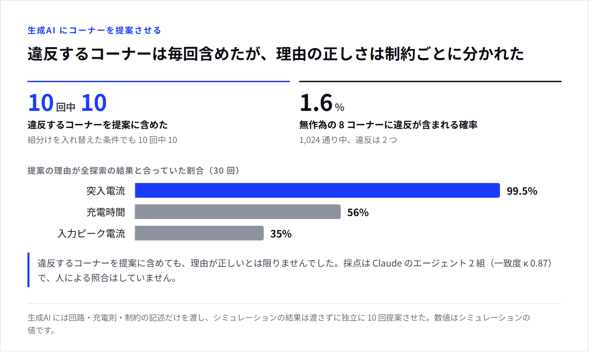
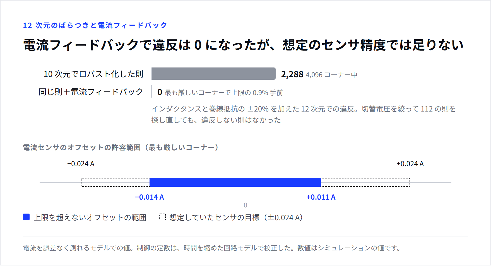
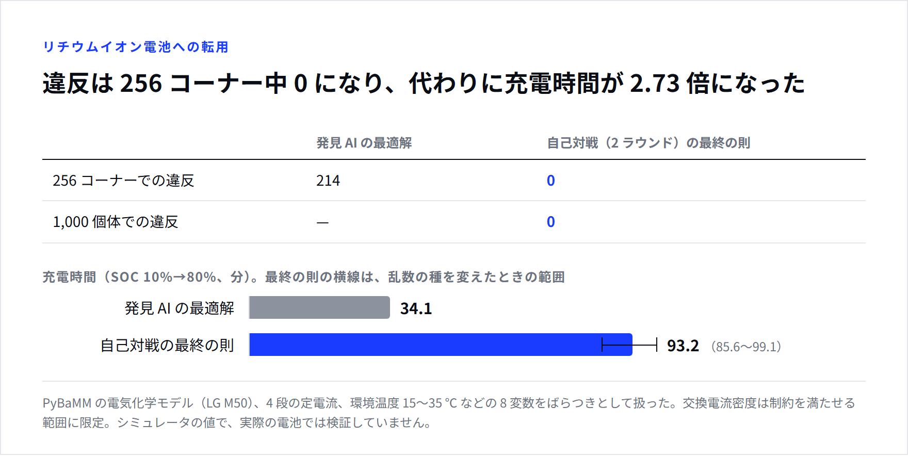

近藤悠太です。学生AIリーダーズ大賞 2026 の研究（自己対戦型の自律実験）では、応募した後にも追加の検証を行い、最終審査のスライドの後半に載せました。この記事では、その 3 つの検証を紹介します。応募書には含めていない検証で、**数値はすべてシミュレーションの値です。実機と実際のリチウムイオン電池では検証していません。**

研究の全体は別の記事に書きました。

https://zenn.dev/kd_yuta/articles/ai-leaders-2026-self-play-experiment

## 生成AI に違反するコーナーを提案させる

応募したときの反証 AI は、人が置いたコーナー（各部品の値を上限か下限に置いた組み合わせ）4 点を初期点にしていました。応募後は、この初期点を生成AI（大規模言語モデル）に提案させる方法を試しました。

対象は応募時の最終の充電則です。ばらつき 10 次元のコーナー 1,024 通りを全部シミュレーションすると、違反するのは 2 つだけでした。生成AI には、回路と充電則と制約の記述だけを渡し、シミュレーションの結果は渡さずに、独立に 10 回提案させました。

- 生成AI は、10 回中 10 回、違反するコーナーを提案に含めました。部品の組分けを入れ替えた条件でも 10 回中 10 回でした。無作為に選んだ 8 個のコーナーに違反が含まれる確率は 1.6% です。
- 一方で、提案の理由の正しさは制約ごとに分かれました。理由を全探索の結果と照合して採点すると（30 回）、突入電流についての主張は 99.5% が正しかったのに対し、入力ピーク電流は 35%、充電時間は 56% でした。採点は Claude のエージェント 2 組が行い（一致度 κ 0.87）、人による照合はしていません。

違反するコーナーは提案に含めたものの、理由が正しいとは限らない、という結果です。

## 12 次元のばらつきと電流フィードバック

応募時は、ばらつきとしてセルの容量だけを扱いました。応募後は、10 次元のばらつきに対してロバスト化した充電則に、インダクタンスと巻線抵抗の ±20% を加えた 12 次元で検査しました。すると、4,096 コーナー中 2,288 で違反しました。

切替電圧を絞って 112 の充電則を探し直しても、違反しない則は見つかりませんでした。そこで、充電則はそのままで電流フィードバックを加えたところ、違反は 4,096 コーナー中 0 になりました（最も厳しいコーナーで上限の 0.9% 手前）。

ただし、これは電流を誤差なく測れるモデルでの値です。電流センサのオフセットが約 +0.011 A か −0.014 A を超えると、最も厳しいコーナーで上限を超えます。想定していたセンサの目標（±0.024 A）では足りません。制御の定数は、時間を縮めた回路モデルで校正しています。

## リチウムイオン電池の急速充電への転用

同じ手順を、リチウムイオン電池の急速充電に当てはめました。PyBaMM の電気化学モデル（LG M50）で、充電率（SOC）10% から 80% までを 4 段の定電流で充電し、環境温度 15〜35 ℃ などの 8 変数をばらつきとして扱っています。

- 発見 AI の最適解（34.1 分）は、256 コーナー中 214 で、温度かリチウム析出の制約に違反しました。
- 自己対戦（2 ラウンド）の最終の則では、違反は 256 コーナー中 0、1,000 個体中 0 になりました。
- その代わりに、充電時間は 2.73 倍（93.2 分）になりました。乱数の種を変えると 85.6〜99.1 分です。

交換電流密度は、元の範囲では最も遅い充電でもリチウム析出の制約を超えてしまうため、制約を満たせる範囲に限定しました。シミュレータの値で、実際の電池では検証していません。

## おわりに

3 つの検証で共通していたのは、反証の対象を広げるたびに、それまで安全だと思っていた則の違反が見つかったことです。10 次元のばらつきで直した則は、インダクタンスと巻線抵抗を加えると、半分以上のコーナーで違反しました。生成AI の提案も、違反するコーナーを含めることと、理由が正しいことは一致しませんでした。

足りないものとして、実機での測定とシミュレーションとの差の定量化、ばらつきの範囲を部品の実測で決めること、電流フィードバックに要る精度の電流センサ、温度と劣化を反証の範囲に入れることが残っています。

- 研究の詳細と発表スライド：https://kondo-yuta-my-portfolio.vercel.app/research/self-play-autonomous-experiment
