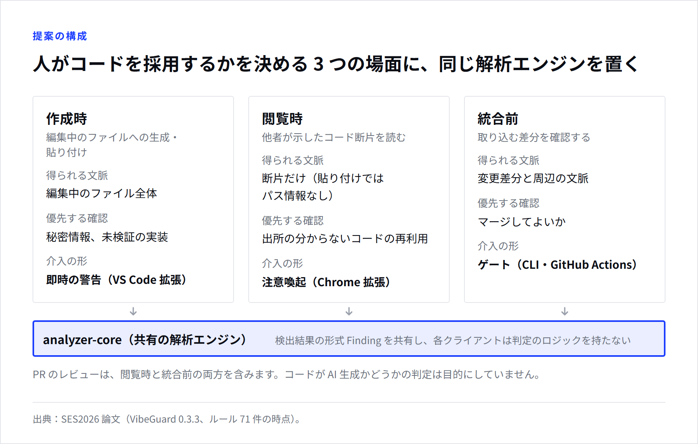
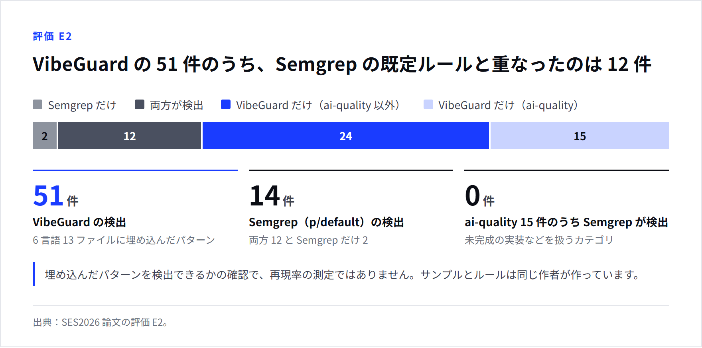
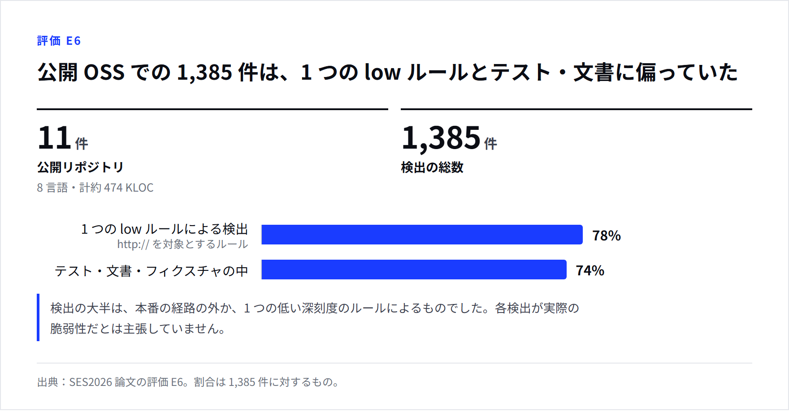

近藤悠太です。2026 年 9 月 11 日に、情報処理学会のソフトウェアエンジニアリングシンポジウム 2026（SES2026、慶應義塾大学 日吉キャンパス）で、一般論文「AI生成コードの採用判断点に基づくマルチコンテキストセキュリティ診断配置方式の提案とVibeGuardによる検証」を発表しました。セッションはコード解析・セキュリティ・テスト支援で、単著の論文です。

この記事では、論文の考え方と評価の結果を、論文に書いた限定とあわせて紹介します。数値は論文の時点（VibeGuard 0.3.3、ルール 71 件）のものです。

## 扱った問題

生成AI が出力したコードには、SQL の文字列連結、`innerHTML` への代入、TLS 検証の無効化、仮の認証、DEBUG 設定の残存、例外の握りつぶし、空のバリデータのような危険な書き方が含まれることがあります。しかも一見すると動作するので、危険に気づかないまま採用されることがあります。

一方、既存の静的解析（SAST）や CI のスキャンが見るのは、主にリポジトリに取り込まれた後のコードです。技術ブログや AI とのチャット、GitHub の PR のように、ブラウザで読むコード断片は対象になりにくく、場面ごとに別のツールを使うと、同じコードに違う判定と違う形式の警告が出ます。

## 採用判断点

論文では、AI 生成コードの安全確認を、コードを生成したときではなく、**人がそのコードを採用するかを判断する場面**の問題として扱いました。この場面を採用判断点と呼び、判断の対象がどこにあるかで 3 つに分けています。

| 採用判断点 | 得られる文脈 | 優先する確認 | 介入の形 |
|---|---|---|---|
| 作成時（編集中のファイルへの生成・貼り付け） | 編集中のファイル全体 | 秘密情報、未検証の実装 | 即時の警告（VS Code 拡張） |
| 閲覧時（他者が示したコード断片を読む） | 断片だけ（貼り付けではパス情報なし） | 出所の分からないコードの再利用 | 注意喚起（Chrome 拡張） |
| 統合前（取り込む差分を確認する） | 変更差分と周辺の文脈 | マージしてよいか | ゲート（CLI・GitHub Actions） |

PR のレビューは、閲覧時と統合前の両方を含みます。論文の仮説は、これらの判断点に同じ基準の診断を置けば、確認の機会が増え、場面をまたいで一貫した修正の判断を支援できる、というものです。なお、コードが AI 生成かどうかを判定することは目的にしていません。

## VibeGuard の構成

検証用のプロトタイプとして作ったのが VibeGuard です。VS Code 拡張、Chrome 拡張、CLI、GitHub Actions の 4 つのクライアントが、同じ解析エンジン（analyzer-core）と同じ検出結果の形式（Finding）を共有します。各クライアントは解析する対象を渡して結果を受け取るだけで、判定のロジックを持ちません。



検出結果には severity（深刻度）と confidence（確信度）の 2 つの軸があります。コメントやテスト用のパスで見つかったものは confidence を下げますが、下げてよい下限を severity で決めています。

```text
c' = max(c0 − Σ p_i, min(c0, f(s)))
```

`p_i` はコメント・docstring なら 2、テストなどのパスなら 1 のペナルティで、`f(s)` は critical と high なら 2、medium なら 1、low と info なら 0 です。confidence は下げるだけで、上げることはありません。

解析は原則として手元で行い、コードを外部へ送りません。ただし、提供する機能は場面ごとに同じではありません。ファイルをまたぐ解析と lockfile による抑制は CLI と GitHub Actions だけにあり、VS Code の保存時のスキャンは、既定では critical と high に絞っています。

## 評価

論文では 7 つの項目（E1〜E7）を測りました。主なものを挙げます。

- **判定の一致（E1）**：71 件の検出を、ruleId・severity・confidence・category・行位置まで比べ、Node 向けのビルドとブラウザ向けのビルドで相違は 0 件でした。確かめたのは共有する解析コアの判定の一致で、実際の画面や Actions 上での一致は今後の検証です。
- **脆弱なサンプル（E2）**：6 言語 13 ファイルに埋め込んだパターンから 51 件を検出しました。Semgrep（p/default）と比べると、両方が検出したものが 12 件、VibeGuard だけが 39 件（うち、未完成の実装などを扱う ai-quality が 15 件）、Semgrep だけが 2 件でした。ai-quality の 15 件を Semgrep の既定のルールは 1 件も検出していません。ただし、これは埋め込んだパターンの検出の確認で、再現率の測定ではありません。
- **安全なサンプル（E3）**：4 ファイルで検出は 0 件でした。ファイル数が少ないので、実際のコードでの誤検知率は別に測る必要があります。
- **PR の差分（E4）**：追加した行に重なる検出だけを残す方式で、3 つの場面の削減率は 97.5%、100%、97.5% でした。
- **実行時間（E5）**：CLI の実行時間（Node.js の起動を含む 3 回の中央値）は、1 ファイルで 120 ms、サンプル一式で 151 ms、リポジトリ全体で 1.8 s でした。
- **公開 OSS への適用（E6）**：8 言語 11 件の公開リポジトリ（計約 474 KLOC）で 1,385 件を検出しました。ただし、全体の 78% は `http://` を対象とする 1 つの low のルールによるもので、検出の 74% はテスト・文書・フィクスチャの中にありました。各検出が実際の脆弱性だとは主張していません。
- **確信度の補正（E7）**：confidence が medium 以上の 230 件に、同じ系統の大規模言語モデル 3 つの多数決（Fleiss の κ = 0.856）でラベルを付けました。補正の下限を外すと、本番の経路にある指摘の割合は 26.5% から 48.8% に上がりました。一方、出荷する構成では下限がこれを押し戻すので、確認の手間は減りません。





## 論文に書いた限定

- VibeGuard はルールベースの検出器で、データフロー解析や依存ライブラリの既知の脆弱性は主な対象ではありません。
- サンプルとルールを同じ作者（私）が作っており、評価の対象に AI 生成コードそのものは含まれていません。
- E7 のラベルは同じ系統の大規模言語モデルが付けたもので、熟練者が付けた正解ではありません。
- 確認の機会が増えるか、修正の判断を支援できるかという仮説の後半は、開発者実験が必要なので、この論文では検証していません。

## 論文の後

論文を投稿した後もルールを足し、現在の公開版（0.3.6）のルールは、1 ファイルを見るルールが 74 件、ファイルをまたぐルールが 11 件の計 85 件です。GitHub Marketplace（Action）、VS Code Marketplace、Chrome Web Store、Open VSX Registry の 4 つで公開しています。

## おわりに

この研究では、新しい検出技術ではなく、同じ解析エンジンを採用判断点に置くことを提案しました。中でも、ブラウザで他者のコードを読む「閲覧時」は、従来の静的解析が扱いにくい場面です。今後は、熟練者が付けた正解つきのベンチマークと、開発者実験に取り組む予定です。

- SES2026 のプログラム：https://ses.sigse.jp/2026/program.html
- 予稿（ソフトウェアエンジニアリングシンポジウム2026論文集、pp. 78–85）：https://ipsj.ixsq.nii.ac.jp/records/2011748
- VibeGuard の公式サイト：https://vibeguard-site.kondo-yuta-02.workers.dev
- リポジトリ：https://github.com/YUTAKONDO1205/VibeGuard

2026 年 11 月 14 日の時点では、情報処理学会の電子図書館がシステムメンテナンスで停止していて、予稿のページは開けません。
