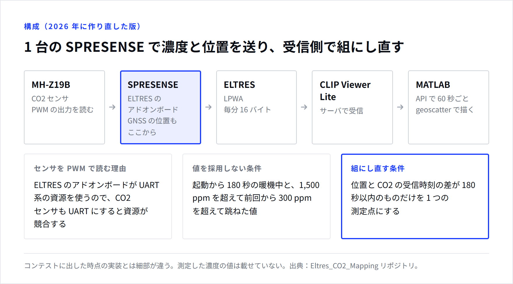
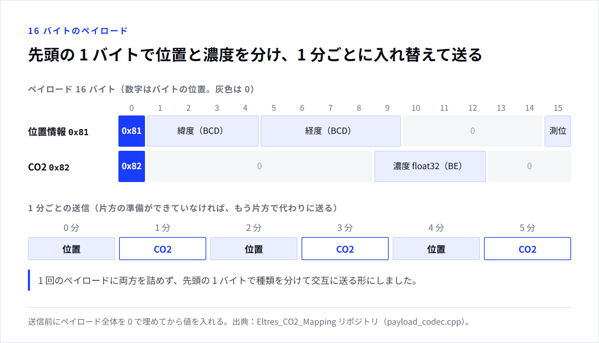

近藤悠太です。2024 年の SPRESENSE 活用コンテストに出した作品「SPRESENSEとELTRES通信でCO2濃度をマッピング」で、クレスコ ELTRESアドオンボード優秀賞をいただきました。作品の解説は Elchika に書いています。

https://elchika.com/article/504f286c-413b-47d3-89f9-38920ca5e5c7/

その後、2026 年にこの作品をリポジトリとして作り直しました。この記事では、作り直した版の実装のうち、1 台の SPRESENSE で CO2 濃度と位置情報を交互に送る部分を説明します。コンテストに出した時点の実装とは、細部が違います。

## 構成

SPRESENSE に、ELTRES のアドオンボードと CO2 センサ（MH-Z19B）を載せています。ELTRES はソニーの LPWA で、GNSS で取った位置もこのボードから得ます。送ったデータは CLIP Viewer Lite のサーバに届き、MATLAB から API で取得して地図に描きます。



## CO2 センサを PWM で読む理由

ELTRES のアドオンボードは UART 系の資源を使います。CO2 センサも UART で接続すると、資源が競合して設計が複雑になります。そこで、MH-Z19B は PWM の出力を読む構成にしました。PWM の 1 周期の High の時間 Th と Low の時間 Tl を `pulseIn` で測り、次の式で濃度に換算して、400〜5,000 ppm の範囲に収めます。

```text
ppm = 5000 × (Th − 2000) / (Th + Tl − 4000)    （時間の単位は µs）
```

センサの暖機として起動から 180 秒は値を使わず、その後は 5 秒ごとに読みます。値が 1,500 ppm を超え、かつ前回から 300 ppm を超えて跳ねたときは、その値を保留して採用しません。

## 16 バイトのペイロード

ELTRES で 1 回に送るペイロードは 16 バイトです。先頭の 1 バイトで種類を分けています。

| バイト | 位置情報（`0x81`） | CO2（`0x82`） |
|---|---|---|
| [0] | `0x81` | `0x82` |
| [1]〜[4] | 緯度（ddmm.mmmm を BCD で） | 0 |
| [5]〜[8] | 経度（dddmm.mmmm。[5] に先頭の 1 桁、続きを BCD で [9] まで） | 0 |
| [9]〜[12] | [9] は経度の最後の 2 桁、[10]〜[12] は 0 | 濃度（float32、ビッグエンディアン） |
| [15] | 測位の状態 | 0 |

## 交互に送る

送信は 1 分ごとで、送るたびに位置情報と CO2 を入れ替えます。片方の準備ができていなければ、もう片方で代わりに送ります。

```cpp
if (preferGpsPayload) {
  if (trySetGpsPayload(nowMs)) { preferGpsPayload = false; return; }
  if (trySetCo2Payload(nowMs)) { /* GPS が未準備なので CO2 で代用 */ return; }
} else {
  if (trySetCo2Payload(nowMs)) { preferGpsPayload = true; return; }
  if (trySetGpsPayload(nowMs)) { /* CO2 が未準備なので GPS で代用 */ return; }
}
```

1 回のペイロードに両方を詰めず、交互に送る形にしたので、受信側では位置と濃度を組にし直す必要があります。



## MATLAB 側で組にし直す

MATLAB からは、CLIP Viewer Lite の API でトークンを取り、デバイスごとの最新のペイロードを 60 秒ごとに取得します。API の側で復号された位置と濃度の値を使い、位置と CO2 の受信時刻の差が 180 秒以内のものだけを 1 つの測定点として組にします。差が開いたものは組にせず保留します。組にした点は `geoscatter` で地図に描いています。

## この記事で扱っていないこと

- 測定した濃度の値は載せていません。作り直したリポジトリには、測定値のデータを含めていないためです。
- 地図の密度図やヒートマップは、測定点から分布を見やすくした図で、すべての場所を直接測ったものではありません。地図上の空白は、濃度が低いとは限らず、測定点が少ないだけのことがあります。

## おわりに

1 台の SPRESENSE で CO2 濃度と位置を扱うときの制約は、計算よりも、通信の資源と 1 回に送れる 16 バイトの側にありました。そのため、センサの接続を PWM に替え、ペイロードを種類で分けて交互に送り、組にし直す処理を受信側に置きました。

- リポジトリ：https://github.com/YUTAKONDO1205/Eltres_CO2_Mapping
- 受賞作品の一覧：https://elchika.com/promotion/spresense2024/winner/
