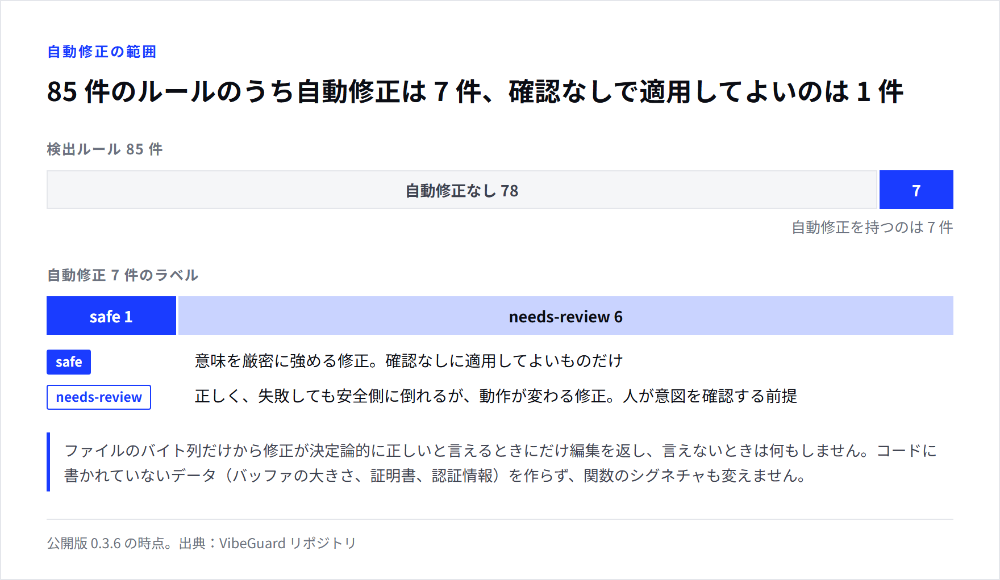
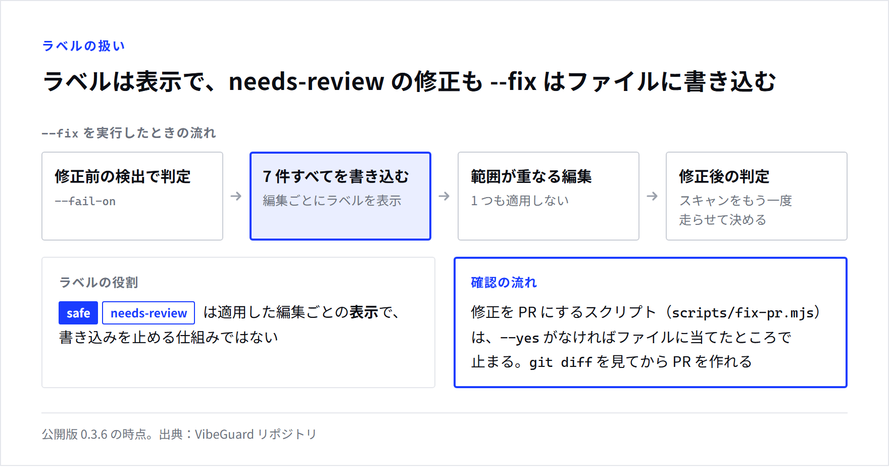

近藤悠太です。AI 生成コードの診断ツール VibeGuard には、検出した問題をファイルに書き戻す自動修正（`--fix`）があります。85 件ある検出ルールのうち、自動修正を持つのは 7 件だけです（公開版 0.3.6 の時点）。この記事では、なぜ 7 件に絞ったのかと、修正に付けている 2 種類のラベルを説明します。

## 自動修正の原則

自動修正の側の原則は 1 つで、ファイルのバイト列だけから修正が決定論的に正しいと言えるときにだけ編集を返し、言えないときは何もしない、というものです。コードに書かれていないデータ（バッファの大きさ、証明書、認証情報）を作り出すことも、関数のシグネチャを変えることもしません。

言い換えると、自動修正は、それを呼び出した検出ルールより厳しくなければなりません。修正が正しいとバイト列から確かめられなければ、修正を見送り、検出だけを報告に残します。この原則を当てはめると、修正を自動で書けるルールは多くありません。

## safe と needs-review

7 件の修正には、どちらかのラベルを付けています。

- **safe**：意味を厳密に強める修正です。確認なしに適用してよいものだけに付けます。
- **needs-review**：正しく、失敗したときに安全側に倒れる修正ですが、動作が変わります（TLS のハンドシェイクで証明書の検証が始まる、迂回のフラグが切れる、など）。人が意図を確認する前提のものです。

| ルール | 修正 | ラベル |
|---|---|---|
| VG-EMB-020 | デバッグ用の定義を 0 にする | safe |
| VG-EMB-021 | 迂回のフラグを切る | needs-review |
| VG-EMB-011 | 証明書の検証を必須にする | needs-review |
| VG-EMB-010 | 接続先を https にする | needs-review |
| VG-RTOS-004 | 書き込みの永続化のため O_SYNC を付ける | needs-review |
| VG-INJ-020 | マージのループでプロトタイプのキーを飛ばす | needs-review |
| VG-AISC-001 | 取り違えたパッケージ名の import を、本来の名前に直す | needs-review |

safe は 1 件だけです。ほかの 6 件は、修正としては正しくても、動いていたものの振る舞いを変えるので、適用してよいかはコードの持ち主が決めることだと考えています。

## ラベルの扱い

ここは誤解されやすいので、はっきり書いておきます。CLI の `--fix` は、needs-review の修正も含めて 7 件すべてをファイルに書き込みます。ラベルは、適用した編集ごとに `[safe]` か `[needs-review]` と表示するだけで、書き込みを止める仕組みではありません。

確認の流れとしては、次の 2 つを用意しています。

- 修正を PR にするスクリプト（`scripts/fix-pr.mjs`）は、`--yes` を付けない限り、修正をファイルに当てたところで止まります。`git diff` を見てから PR を作れます。
- `--fail-on` は、修正する前の検出で判定します。修正を当てたことは、検出が解消した証拠にはならないからです。修正後の判定は、スキャンをもう一度走らせて決めます。

また、2 つの編集の範囲が重なった場合は、1 つも適用しません。一部だけを当ててファイルを壊さないためです。

## おわりに

自動修正の数を増やすことはできます。しかし、バイト列から正しいと言えない修正を当てると、診断ツールが新しい不具合を持ち込むことになります。修正の数よりも、当てた修正のうちどれが振る舞いを変えるかを、使う人に正確に伝えることを優先しました。

- リポジトリ：https://github.com/YUTAKONDO1205/VibeGuard
- VibeGuard の公式サイト（ルールの一覧）：https://vibeguard-site.kondo-yuta-02.workers.dev
