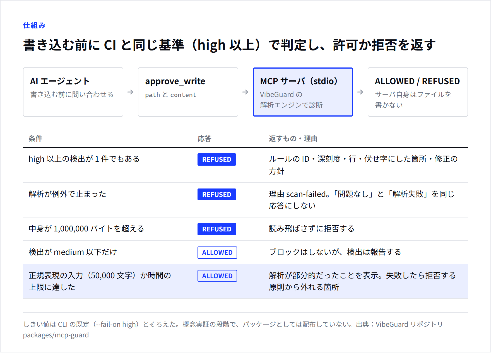
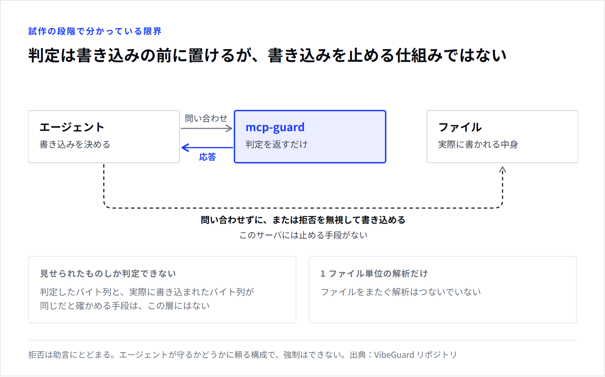

近藤悠太です。AI 生成コードの診断ツール VibeGuard の解析エンジンを、AI のコーディングエージェントがファイルを書き込む前に呼び出せるように、MCP（Model Context Protocol）のサーバとして試作しました。この記事では、その仕組みと、試作の段階で分かっている限界を書きます。

**このサーバは概念実証の段階です。コードはリポジトリにありますが、パッケージとしては配布していません。**

## 仕組み

stdio で動く MCP サーバで、ツールは `approve_write` の 1 つだけです。エージェントは、書き込もうとしているファイルのパス（`path`）と中身（`content`）を渡します。サーバは、その中身を VibeGuard の解析エンジンで診断し、`ALLOWED` か `REFUSED` を返します。

- `high` 以上の検出が 1 件でもあれば `REFUSED` を返します。拒否するときは、ルールの ID、深刻度、行、伏せ字にした該当箇所、修正の方針を返すので、エージェントは直してから呼び直せます。
- それ以外は `ALLOWED` を返します。`medium` 以下の検出も、ブロックはしませんが報告はします。
- サーバ自身は、ファイルを一切書きません。`path` は言語の判定とラベルにだけ使い、そのパスのファイルを開くことも作ることもしません。

しきい値を `high` にしたのは、CLI の既定（`--fail-on high`）と揃えるためです。CI でマージを止めるものと同じものを、書き込みの前に止めるだけで、より厳しい基準は持ち込んでいません。`medium` には確信度の低いルールが多く、そこまでブロックすると、エージェントが抜けられないループに入り、人がこのサーバを設定から外すことになると考えました。

## 失敗時の拒否

解析が例外で止まったときは、書き込みを拒否します（理由は `scan-failed`）。「問題がなかったので許可」と「解析が落ちたので許可」は、エージェントから見ると同じ応答になってしまうからです。中身が 1,000,000 バイトを超える場合も、読み飛ばさずに拒否します。

## 試作の段階で分かっている限界

- **拒否は助言にとどまります。** エージェントが問い合わせずに書き込んだり、拒否を無視して書き込んだりしても、このサーバには止める手段がありません。
- **見せられたものしか判定できません。** 判定したバイト列と、実際に書き込まれたバイト列が同じだと確かめる手段は、この層にはありません。
- **解析が途中までしか読めなかったときは許可します。** 正規表現の入力の上限（50,000 文字）や時間の上限に達した場合で、拒否すると 50 KB を超えるファイルが永久に書けなくなるためです。許可の応答に、解析が部分的だったことを表示します。これは設計の中で、失敗したら拒否するという原則から外れている箇所です。
- **1 ファイル単位の解析だけです。** ファイルをまたぐ解析はつないでいません。

## おわりに

この試作で考えたのは、エージェントの書き込みの前という、人がコードを読む前の場面に、CI と同じ判定を前倒しで置けるかということでした。仕組みとしては置けますが、強制はできません。エージェントが守るかどうかに頼る以上、どこまでを約束し、どこからを約束しないかを、限界として書いておく必要があると考えています。

- リポジトリ（`packages/mcp-guard`）：https://github.com/YUTAKONDO1205/VibeGuard
