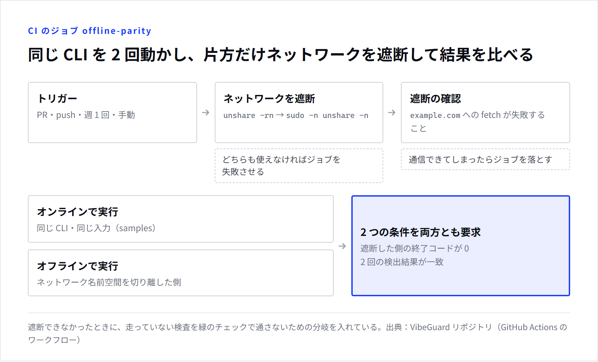
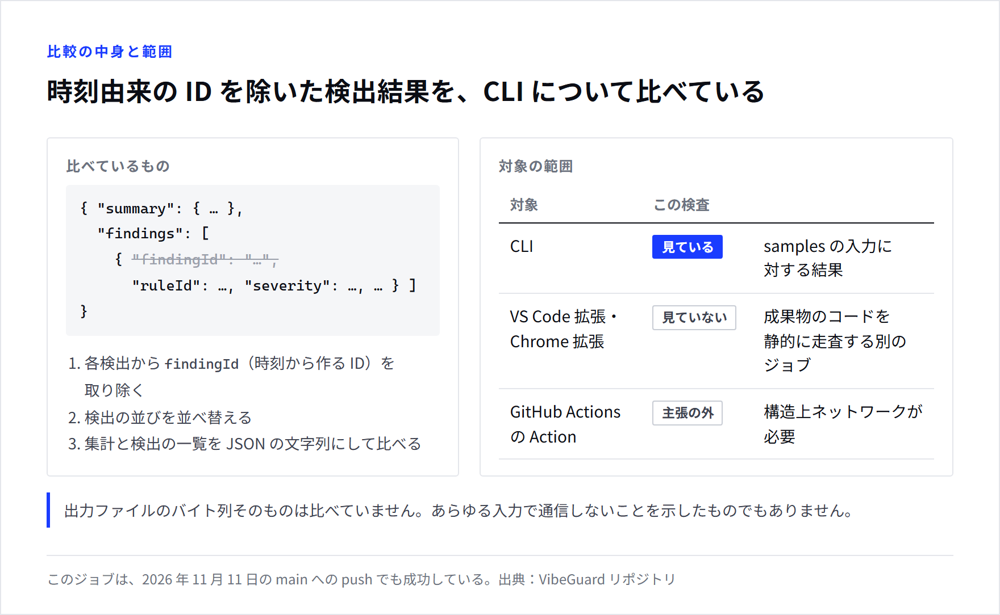

近藤悠太です。AI 生成コードの診断ツール VibeGuard は、解析を手元の端末で完結させ、コードを外部へ送らないことを方針にしています。この記事では、その方針を説明文で約束するだけでなく、CI で確かめるために作ったワークフローを紹介します。

## 確かめたいこと

外部へ通信するツールをネットワークのない環境で動かすと、エラーで止まるか、結果が変わるはずです。逆に、ネットワークを切っても正常に終わり、結果も変わらないなら、そのツールはネットワークを必要としていないと判断できます。そこで、同じ CLI を同じ入力に対して 2 回動かし、片方だけネットワークを遮断して、次の 2 つを両方とも要求することにしました。

- 遮断した側でも、CLI が終了コード 0 で終わること
- 2 回の検出結果が一致すること

## ワークフローの中身

GitHub Actions のジョブ（`offline-parity`）は、main への pull request と push、週 1 回の定期実行、手動の実行で動きます。

ネットワークの遮断には、Linux の `unshare` でネットワーク名前空間を切り離します。`unshare -rn` が使えなければ `sudo -n unshare -n` を試し、どちらも使えなければジョブを失敗させます。遮断できなかったときに、走っていない検査を緑のチェックで通さないためです。遮断した後には、`https://example.com` への `fetch` が実際に失敗することを確かめます。ここで通信できてしまったら、遮断できていないのでジョブを落とします。

そのうえで、オンラインとオフラインのそれぞれで、同じコマンドを実行します。

```bash
node apps/cli/dist/index.js samples \
  --mode standard --format json --out online.json --fail-on never
```



## 比較の中身

比べているのは、出力ファイルのバイト列そのものではありません。検出結果の ID（`findingId`）は時刻から作っているので、実行するたびに変わります。そこで、各検出から `findingId` を取り除き、検出の並びを並べ替えたうえで、集計（`summary`）と検出の一覧を JSON の文字列にして比べています。

```js
const findings = (doc.findings ?? []).map(({ findingId, ...rest }) => rest);
findings.sort((x, y) => JSON.stringify(x).localeCompare(JSON.stringify(y)));
return JSON.stringify({ summary: doc.summary, findings }, null, 2);
```

このジョブは、2026 年 11 月 11 日の main への push でも成功しています。



## この検査で言えないこと

- 対象は CLI だけです。VS Code 拡張と Chrome 拡張は、それぞれの実行環境を動かす仕組みが別に要るので、この検査では見ていません（成果物のコードを静的に走査する別のジョブで見ています）。
- GitHub Actions として配布している Action は、構造上ネットワークが必要なので、この主張の外にあります。
- 比べた入力は `samples` だけで、あらゆる入力で通信しないことを示したものではありません。

## おわりに

説明文の「外部へ送信しません」を CI の検査にすると、何を比べるのか（時刻由来の ID を除いた検出結果）と、どこまでを対象にするのか（CLI だけ）を決める必要がありました。説明文の側も、この範囲に合わせて書くようにしています。

- リポジトリ：https://github.com/YUTAKONDO1205/VibeGuard
- VibeGuard の公式サイト：https://vibeguard-site.kondo-yuta-02.workers.dev
